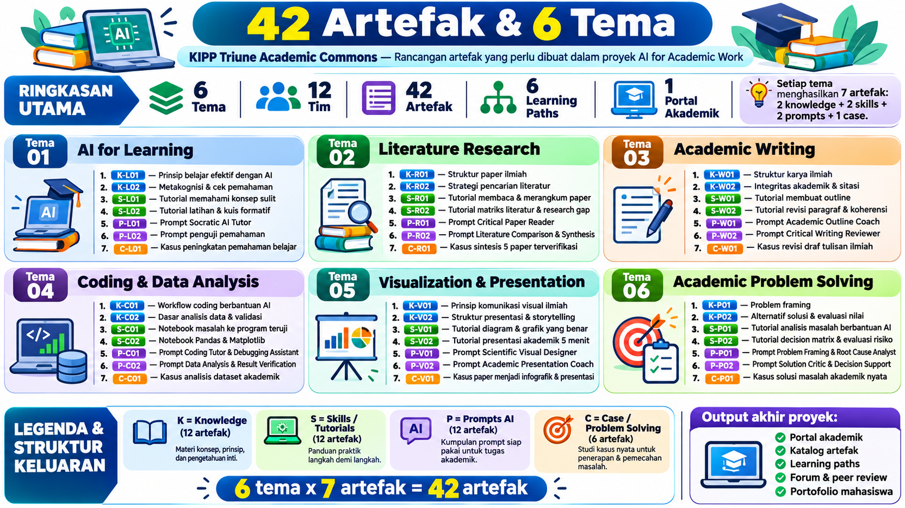
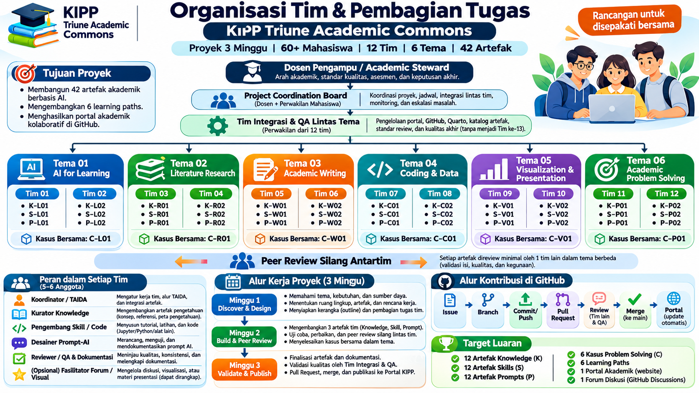

# Empat Jenis Artefak dan Empat Cara Belajar

{#fig-artefacts-1 width="100%" fig-align="center"}

## Knowledge — Learning by Teaching

Artefak **Knowledge** memuat konsep, kerangka, alasan, contoh, dan batasan. Pembuatnya mempelajari sumber, mengajarkan kembali konsep dengan bahasa yang dapat dipahami pengguna, mengajukan pertanyaan pemahaman, lalu memperbaiki penjelasan dari umpan balik. Karena kualitas pengajaran diuji oleh pemahaman penerima, materi tidak cukup hanya merupakan kompilasi teks.

## Skills — Learning by Doing

Artefak **Skills** memuat tutorial yang dapat dijalankan, demonstrasi, masukan–keluaran, cara menguji hasil, kesalahan umum, dan cara memperbaikinya. Skills menyediakan kompetensi transisi dari satu keadaan ke keadaan lain. Tanpa eksekusi demonstratif, daftar langkah belum menjadi bukti keterampilan.

## Prompts — Learning by Instructing

Artefak **Prompts** adalah spesifikasi instruksi untuk AI: tujuan, konteks, masukan, batasan, kriteria, format hasil, dan kebijakan verifikasi. Prompt bukan jaminan kebenaran; ia perlu diuji dengan kasus sederhana, sulit, dan ambigu. Prompts bekerja melintasi seluruh tahapan PUDAL sebagai mekanisme instruksi dan kontrol, bukan satu fase terpisah.

## Case Study — Learning by Demonstrating Problem Solving

**Case Study** mengikat *Perceive, Understand, Decide, Act, Learn* ke dalam masalah nyata atau simulasi yang diberi label jelas. Kasus dimulai dengan keadaan A, kriteria B, dan kendala sumber daya. Ia mendokumentasikan peta, alternatif rute, keputusan, transisi, evaluasi, serta pembelajaran. Kasus yang matang memperlihatkan demonstrasi lengkap dan tantangan baru agar pengguna dapat menguji kompetensinya sendiri.

## Komposisi dan pengorganisasian

Setiap tema dikembangkan oleh dua kelompok. Masing-masing kelompok membuat satu Knowledge, satu Skill, dan satu Prompt; kedua kelompok bersama-sama menyusun satu Case Study dan satu Learning Path. Dengan demikian satu tema memiliki **2 Knowledge + 2 Skills + 2 Prompts + 1 Case = 7 artefak**, dan enam tema memiliki **42 artefak**. Paket agen dan workflow menjadi integrasi di atas artefak tersebut, bukan item tambahan yang dihitung ke dalam 42.

{#fig-teams-1 width="100%" fig-align="center"}

## Mengapa empat artefak harus mempunyai fungsi yang berbeda?

Satu topik dapat ditulis berulang dalam empat berkas tanpa menghasilkan empat manfaat. Knowledge menjawab apa dan mengapa; Skills membantu pengguna melakukan suatu pekerjaan; Prompts memberi spesifikasi bantuan; Case Study menunjukkan bagaimana keputusan dan tindakan bekerja dalam konteks. Perbedaan fungsi ini perlu terlihat pada pengalaman pengguna. Jika semua berkas hanya menjelaskan definisi PUDAL, paketnya belum menyediakan tutorial atau demonstrasi.

Gunakan kasus Bayes sebagai benang pengikat. Knowledge menjelaskan probabilitas bersyarat dan alasan penyebut berubah. Skill mengajarkan pembuatan tabel kontingensi dengan input, langkah, dan pemeriksaan total. Prompt mengarahkan tutor agar mendiagnosis kesalahan sebelum memberi bantuan. Case Study merekam peserta dari jawaban awal keliru sampai mampu menyelesaikan kasus baru. Pembaca dapat berpindah dari satu artefak ke artefak lain sesuai kebutuhannya.

## Kriteria penerimaan yang sesuai fungsi

Knowledge diperiksa dari ketepatan konsep, sumber, contoh, dan batasan. Skills diperiksa melalui eksekusi oleh orang lain; penulis tutorial tidak menjadi satu-satunya penguji karena ia sudah mengetahui langkah yang tersirat. Prompts diperiksa terhadap perilaku pada beberapa masukan, termasuk masukan ambigu dan salah. Case Study diperiksa dari keterlacakan perubahan keadaan dan keputusan, bukan panjang narasinya.

Prinsip keselarasan pembelajaran membantu menyamakan bukti dengan kemampuan yang dituju [@cmu-alignment]. Dalam paket ini, tutorial yang berhasil dijalankan belum membuktikan penguasaan konsep; peserta tetap perlu menjelaskan hasil. Sebaliknya, penjelasan teori yang benar belum menunjukkan bahwa langkah teknis dapat diikuti. Kedua bukti saling melengkapi dan tidak saling menggantikan.

## Satu contoh rantai mutu

Misalkan tutorial meminta pengguna menghitung posterior dengan spreadsheet. Knowledge menyatakan prior 1%, sensitivitas 90%, dan positif palsu 5%. Skill harus menuliskan apakah sel menerima `1%` atau `0.01`, supaya pengguna tidak memasukkan 1 sebagai prevalensi. Prompt yang menghasilkan variasi soal wajib mempertahankan rentang probabilitas yang sah. Case Study kemudian memeriksa bahwa pengguna dapat mengubah parameter dan menafsirkan perubahan.

Kesalahan format input pada Skills dapat membuat Case Study gagal walaupun teori benar. Karena itu reviewer tidak cukup memeriksa setiap berkas secara terpisah. Uji paket dari awal sampai akhir dengan keadaan pengguna yang realistis. Catat titik ketika pengguna perlu menebak atau meminta penjelasan tambahan, lalu pindahkan pengetahuan yang diperlukan ke tempat yang sesuai.

## Mengelola versi, sumber, dan kepemilikan

Setiap artefak memerlukan ID, judul, penanggung jawab, status, versi, prasyarat, dan tautan terkait. Perubahan konsep pada Knowledge harus memicu peninjauan Skills dan Prompts yang bergantung padanya. Jika parameter kasus diganti, perhitungan pembanding dan kunci jawaban ikut diperbarui. Metadata memungkinkan dampak perubahan ini ditelusuri.

Prinsip FAIR membantu memikirkan metadata dan penggunaan ulang sumber digital [@fair2016]. Pada proyek kelas, penerapannya dapat sederhana: ID stabil, istilah yang konsisten, petunjuk akses, atribusi, dan lisensi yang jelas. FAIR tidak menghapus pembatasan akses atas data sensitif. Materi publik sebaiknya memakai contoh yang memang boleh dibagikan.

## Praktikum audit paket

Pasangan kelompok menukar satu paket contoh. Reviewer memulai hanya dari halaman masuk, menjalankan satu tutorial, mencoba prompt, dan memeriksa pembahasan kasus. Ia menulis satu kekuatan, satu kegagalan yang dapat direproduksi, serta satu pertanyaan konsep. Penyusun memperbaiki kegagalan lalu meminta reviewer mengulangi langkah yang sama.

Paket diterima ketika pengguna lain dapat memahami tujuan, memperoleh prasyarat, mengerjakan tindakan, dan menilai hasil tanpa bergantung pada penjelasan lisan pembuat. Jumlah 42 artefak tetap penting untuk kelengkapan proyek, tetapi mutu commons ditentukan juga oleh hubungan antarbagiannya dan kemampuan materi tersebut membantu pengguna menjadi lebih mampu.
