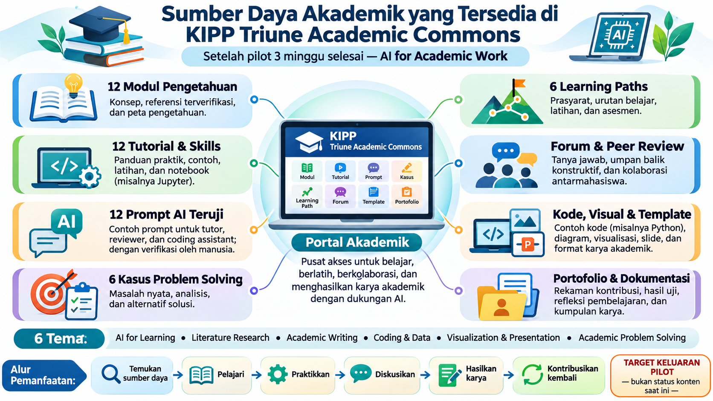

# Energi, Kerja, dan Ekosistem Sumber Daya

## Mesin empat fungsi

Sistem pelaksana kerja memerlukan empat fungsi: **Acquire** memperoleh sumber daya eksternal; **Convert** mengubahnya menjadi bentuk yang bisa digunakan; **Store** menyediakan cadangan; dan **Execute** memobilisasi cadangan untuk pekerjaan. Keempat fungsi dapat berlangsung simultan atau berulang pada setiap stage.

Pada tubuh, makanan dan oksigen mendukung proses metabolik yang menghasilkan bentuk energi kimia tersedia untuk kerja, termasuk ATP; cadangan energi tersebar pada beragam jaringan. Pada mobil, bahan bakar menyediakan energi kimia yang diproses oleh mesin. Pada transportasi berbayar, uang bukan energi fisik tetapi **hak akses/kemampuan membayar** untuk memperoleh layanan yang mengonsumsi energi fisiknya sendiri.

## Mengapa kelimpahan lingkungan relevan

Lingkungan menentukan opsi sumber daya apa yang tersedia di tiap lokasi: makanan/air, listrik, bahan bakar, infrastruktur, uang, data, fasilitas, dan orang yang dapat bekerja sama. Sumber yang **melimpah** memperbesar ruang pilihan, tetapi kelimpahan tidak wajib: yang wajib ialah suplai **cukup, dapat diakses, dapat dikonversi, dan tersedia pada saat diperlukan**.

{#fig-resource width="100%"}

## Neraca fisik dan neraca kapasitas

Untuk satu jenis cadangan energi fisik yang konsisten satuannya, penyederhanaan model:

$$E_{k+1}=E_k+\eta_k Q_k-W_k-L_k.$$

$E_k$ cadangan tersedia, $Q_k$ input energi dari luar, $\eta_k$ efisiensi penyimpanan efektif, $W_k$ energi yang dipakai untuk kerja, dan $L_k$ kehilangan atau kebutuhan lainnya. Persamaan ini **model konseptual**, bukan deskripsi lengkap fisiologi atau termodinamika kendaraan.

Untuk uang, waktu, kuota komputasi, perhatian, dan sumber daya lain, gunakan neraca masing-masing:

$$R^{(j)}_{k+1}=R^{(j)}_k+I^{(j)}_k-C^{(j)}_k.$$

Jangan menjumlahkan rupiah dengan joule sebagai besaran yang sama. Pilihan rute harus memenuhi batas tiap komponen vektor sumber daya $\mathbf R$.

## Titik suplai dan strategi

Milestone dapat sekaligus menjadi titik pengisian ulang, pergantian engine, atau negosiasi akses. Penyusunan rute yang hanya meminimalkan jarak tetapi mengabaikan tempat memperoleh suplai dapat menghasilkan perjalanan yang tidak layak. Karena itu, Understanding memetakan sumber dan Planning memeriksa jadwal suplai di sepanjang rute.

## Ekosistem akademik

Natural memerlukan waktu, perhatian, pengalaman, dan daya kognitif; instrumental memerlukan perangkat, kompetensi operasional, dan data; vehicular memerlukan akses platform, biaya komputasi, prosedur verifikasi, dan kebijakan tanggung jawab. Melalui Collective Intelligence, kelompok dapat berbagi pengetahuan, tugas, dan akses tanpa menganggap kontribusi sosial sebagai joule energi fisik.

## Memisahkan dimensi agar neraca bermakna

Kata energi sering dipakai sehari-hari untuk semangat atau perhatian. Dalam model fisik, energi mempunyai satuan yang dapat diukur seperti joule. Dalam perencanaan akademik, lebih aman mencatat waktu kerja fokus dalam jam, uang dalam rupiah, kapasitas penyimpanan dalam gigabita, dan kuota layanan menurut satuan penyedia. Masing-masing membatasi tindakan dengan cara berbeda.

Waktu kalender juga berbeda dari jam-orang. Dua anggota yang bekerja masing-masing tiga jam menghasilkan enam jam-orang, tetapi dapat memerlukan tiga jam kalender jika tugasnya benar-benar paralel. Jika anggota kedua harus menunggu hasil anggota pertama, durasi bertambah. Perencanaan perlu mencatat kapasitas orang sekaligus dependensi, bukan menjumlahkan semua jam seolah dapat saling menggantikan.

## Contoh neraca proyek dengan cadangan

Kelompok modul Bayes mempunyai 30 jam-orang untuk satu pekan. Rencana awal mengalokasikan delapan jam pembacaan, delapan jam tutorial, enam jam pengujian, dan empat jam penyuntingan, sehingga tersisa empat jam cadangan. Ketika pengujian membutuhkan tambahan lima jam, proyek kekurangan satu jam sekalipun pekerjaan lain sesuai estimasi. Kelompok dapat mengurangi fitur, menambah kapasitas yang sah, atau mengubah jadwal.

Cadangan bukan waktu kosong tanpa tujuan. Ia melindungi proyek dari variasi yang wajar. Besarnya dipilih berdasarkan ketidakpastian dan konsekuensi keterlambatan, bukan persentase yang dianggap berlaku untuk semua kasus. Dalam contoh ini, menghapus seluruh pengujian agar jadwal kembali cocok akan melanggar kriteria mutu B.

| Sumber daya | Tersedia | Kebutuhan rencana | Hal yang perlu diperiksa |
|---|---:|---:|---|
| Jam-orang | 30 | 26 | Apakah keahlian tersedia pada waktu yang tepat? |
| Biaya layanan | Rp100.000 | Rp60.000 | Apakah biaya verifikasi dan pemakaian ulang termasuk? |
| Penguji pengguna | 3 orang | 2 orang | Apakah jadwal dan izin partisipasinya jelas? |

Tabel merupakan ilustrasi. Kelebihan uang tidak otomatis menutup kekurangan waktu penguji. Pertukaran sumber daya memerlukan mekanisme yang nyata, misalnya membayar layanan yang memang tersedia dan diizinkan. Tanpa mekanisme itu, menjumlahkan semuanya menjadi skor anggaran dapat menghasilkan rute semu.

## Acquire, Convert, Store, Execute dalam kerja pengetahuan

Acquire mencakup memperoleh sumber yang sah, akses alat, dan komitmen waktu. Convert mencakup mengekstraksi konsep, membersihkan data, atau mengubah format. Store mencakup penyimpanan dengan metadata dan versi agar dapat ditemukan kembali. Execute menggunakan sumber yang sudah siap untuk analisis, penulisan, atau pengujian. Keempat fungsi ini menjelaskan aliran kerja; istilah konversi informasi tidak berarti pengetahuan berubah menjadi energi fisik.

Kegagalan sering terjadi di antara fungsi. Artikel sudah diunduh tetapi tidak diberi metadata sehingga sulit ditemukan. Dataset tersedia tetapi skema tidak dipahami sehingga belum dapat digunakan. Kuota layanan ada tetapi anggota belum mampu memeriksa output. Kelimpahan input tidak sama dengan kesiapan kerja.

## Menghindari klaim efisiensi yang tidak diukur

Biaya token, lama eksekusi, dan daya perangkat dapat menjadi indikator berbeda. Jangan menyebut satu sistem lebih hemat energi hanya karena lebih murah atau lebih cepat; klaim energi membutuhkan batas pengukuran dan satuan energi. Demikian pula, beban kognitif tidak dapat disimpulkan dari jumlah klik saja. Tentukan konstruk dan instrumennya sebelum membandingkan.

Praktik komputasi yang terorganisasi membantu menghindari kerja ulang, misalnya melalui skrip, struktur data, dan dokumentasi yang dapat dipakai kembali [@wilson2017]. Penghematan pada proyek tertentu tetap harus dicatat dari kondisi aktual. Untuk latihan, buat neraca dua stage dengan sumber daya berbeda dan satu gangguan suplai. Tunjukkan sumber daya mana yang menjadi hambatan serta perubahan rute yang mempertahankan mutu minimum.
