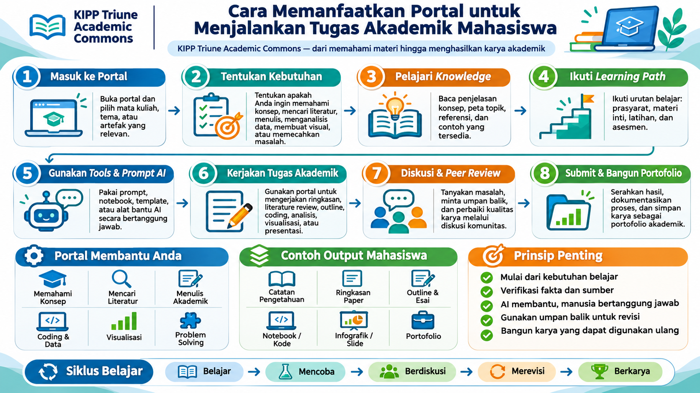

# Dari Model PUDAL menuju Arsitektur Agen Akademik

## Satu agen, satu learning path

Enam agen merupakan paket layanan pembelajaran: *Learning, Research, Writing, Coding & Data, Visualization,* dan *Problem-Solving*. Tiap agen mempunyai kemampuan memahami kebutuhan, menggunakan sumber Knowledge/Skills, menjalankan Prompts dan Tools, mendokumentasikan Case Studies, serta melakukan evaluasi. **Agen tidak harus berupa sistem otonom**: prototipe prompt–workflow yang dipandu manusia sudah memadai untuk pilot UAS.

{#fig-portal-1 width="100%" fig-align="center"}


## Komponen paket agen

Struktur usulan (bukan klaim bahwa semua file sudah dibuat):

```text
agents/<theme>/
  README.md
  agent.yaml
  system-prompt.md
  workflow-pudal.yaml
  decision-policy.yaml
  resources.yaml
  tools.yaml
  evaluations/
```

`agent.yaml` mendefinisikan tujuan dan kewenangan; `workflow-pudal.yaml` memetakan lima tingkat; `decision-policy.yaml` menjelaskan pemilihan natural/instrumental/vehicular; `resources.yaml` menjelaskan kebutuhan sumber daya; `evaluations/` memuat kasus uji, rubrik, dan laporan hasil. Knowledge, Skills, dan Prompts yang sudah ada dipautkan, tidak diduplikasi.

## Kerja sama tiga kecerdasan

Individual Intelligence menetapkan arah, memahami dan mempertanggungjawabkan hasil. Collective Intelligence memberi peer review, pilihan alternatif, kemampuan tim, serta kurasi bersama. Artificial Intelligence membantu pencarian, eksperimentasi, drafting dan validasi awal. Agen PUDAL harus tetap transparan tentang sumber informasi, ketidakpastian dan pembagian tugas.

## Mekanisme pengendalian

Pada tiap tahap: lakukan identifikasi keadaan, bandingkan sasaran milestone, minta rekomendasi engine, cek kendala sumber daya, tampilkan alasan pemilihan rute, laksanakan tindakan dengan otorisasi relevan, kemudian simpan bukti hasil. Jika memerlukan tindakan eksternal berbiaya atau berdampak, minta persetujuan manusia terlebih dahulu.

## Dari enam agen ke orkestrasi

Sebuah pekerjaan penulisan riset dapat memanggil Problem-Solving untuk merumuskan masalah, Research untuk sintesis referensi, Coding & Data untuk analisis, Writing untuk argumentasi, Visualization untuk presentasi, dan Learning untuk menutup kesenjangan kompetensi. Handoff antaragen harus memuat state, tujuan, sumber yang digunakan, verifikasi, dan batas kewenangan.

## Merancang layanan dari tugas pengguna

Sebelum memilih kerangka agen, tentukan tugas minimum: menerima tujuan, membaca sumber yang diizinkan, mengusulkan langkah, menghasilkan keluaran, dan menyediakan bukti. Learning Agent untuk Bayes dapat berupa workflow terpandu dengan beberapa prompt dan tabel acuan. Otonomi ditambah hanya jika fungsi tambahan memang dibutuhkan dan hasilnya dapat dikendalikan.

Pisahkan komponen perencana, pengambil sumber, pelaksana alat, penyimpan keadaan, dan pemeriksa. Pemisahan ini dapat bersifat logis dalam satu aplikasi; tidak harus ada model berbeda untuk setiap peran. Yang penting ialah mengetahui komponen mana menghasilkan klaim dan komponen mana mengujinya. Meminta model yang sama menyatakan “jawaban saya benar” tidak cukup sebagai verifikasi independen.

## Kontrak masukan, keluaran, dan provenance

Masukan agen memuat tujuan, profil prasyarat, sumber yang tersedia, batas bantuan, dan kriteria penerimaan. Keluaran sebaiknya menyertakan hasil, sumber, hal yang belum pasti, pengujian, dan tindakan berikutnya. Jika sumber tidak ditemukan, agen menyatakan keterbatasan tersebut. Mengisi kekosongan dengan referensi yang tampak masuk akal merusak seluruh rantai bukti.

Untuk Research Agent, setiap ekstraksi mengacu pada identitas dokumen dan lokasi bagian. Untuk Coding & Data Agent, keluaran mengacu pada data, skema, versi prosedur, dan hasil eksekusi. Untuk Writing Agent, perubahan klaim dibedakan dari penyuntingan bahasa. Kontrak yang berbeda ini mengikuti karakter tugas, sehingga format tunggal yang terlalu umum dapat kehilangan informasi penting.

## Keamanan sumber dan kewenangan alat

Dokumen yang dibaca agen merupakan data untuk ditelaah. Teks di dalamnya yang meminta penghapusan berkas, pengiriman data, atau pengubahan tujuan tidak memperoleh kewenangan hanya karena ada di sumber. Aturan alat berasal dari mandat pengguna dan kebijakan sistem. Pisahkan pembacaan sumber dari eksekusi tindakan, terutama ketika sumber berasal dari Internet atau unggahan pihak lain.

Gunakan kewenangan sesuai tugas, log tindakan, dan lingkungan uji untuk perubahan yang belum diperiksa. Kredensial tidak disimpan dalam prompt atau repositori publik. Batas biaya dan jumlah percobaan mencegah loop alat berjalan tanpa manfaat. NIST AI RMF menyediakan kerangka umum untuk pengelolaan risiko dan tanggung jawab [@nist2023]; kontrol teknis ini adalah usulan implementasi untuk konteks buku.

## Handoff yang mempertahankan konteks

Research Agent menyerahkan kepada Writing Agent pertanyaan, klaim yang didukung, lokasi bukti, dan batas interpretasi. Writing Agent tidak perlu menerima semua log pencarian jika ringkasan terstruktur cukup, tetapi sumber rinci tetap tersedia. Visualization Agent menerima angka dan satuan yang telah diperiksa, bukan hanya permintaan membuat grafik yang menarik.

Jika agen berikutnya menemukan ketidakcocokan, ia mengembalikan pertanyaan dengan objek yang jelas. Misalnya, “angka 15,38% benar untuk parameter 1%, 90%, dan 95%; narasi terbaru menyebut prevalensi 5%.” Handoff yang baik memungkinkan koreksi lokal tanpa mengulang seluruh pekerjaan dan tanpa menyembunyikan perubahan asumsi.

## Evaluasi sebelum memperluas penggunaan

Uji workflow pada kasus normal, miskonsepsi yang diketahui, informasi tidak lengkap, sumber bertentangan, serta layanan alat yang gagal. Catat apakah sistem meminta klarifikasi yang relevan, menyatakan ketidakpastian, dan menghentikan tindakan di luar mandat. Untuk tutor, nilai juga kualitas bantuan: apakah ia memberi petunjuk yang sesuai atau langsung mengerjakan tugas peserta?

Mulai dari mode rekomendasi dengan pemeriksaan manusia. Perluasan kewenangan didasarkan pada bukti perilaku dan dampak yang dapat diterima. Sebagai latihan, tulis satu kontrak agen untuk modul Bayes dan tiga kasus uji dengan hasil yang diharapkan. Spesifikasi dianggap cukup jelas ketika reviewer dapat menilai perilaku yang benar tanpa menebak niat pembuatnya.
