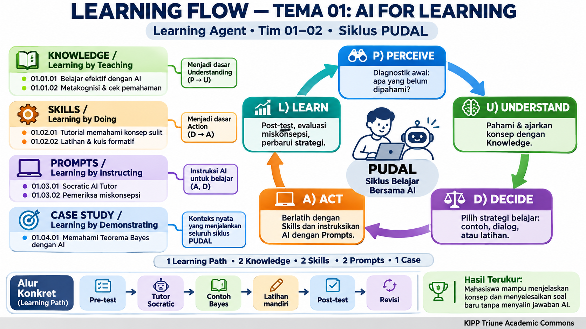
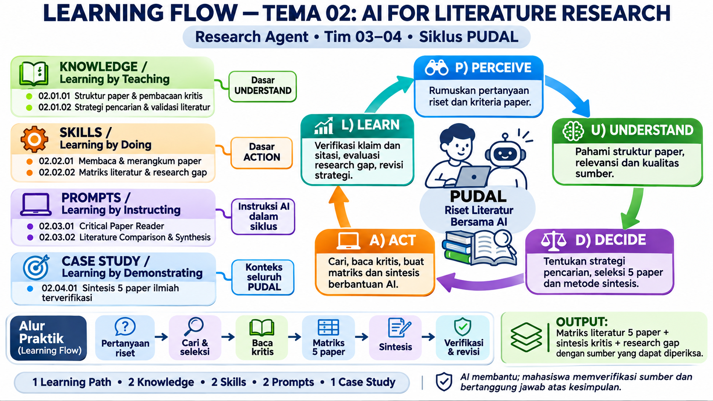
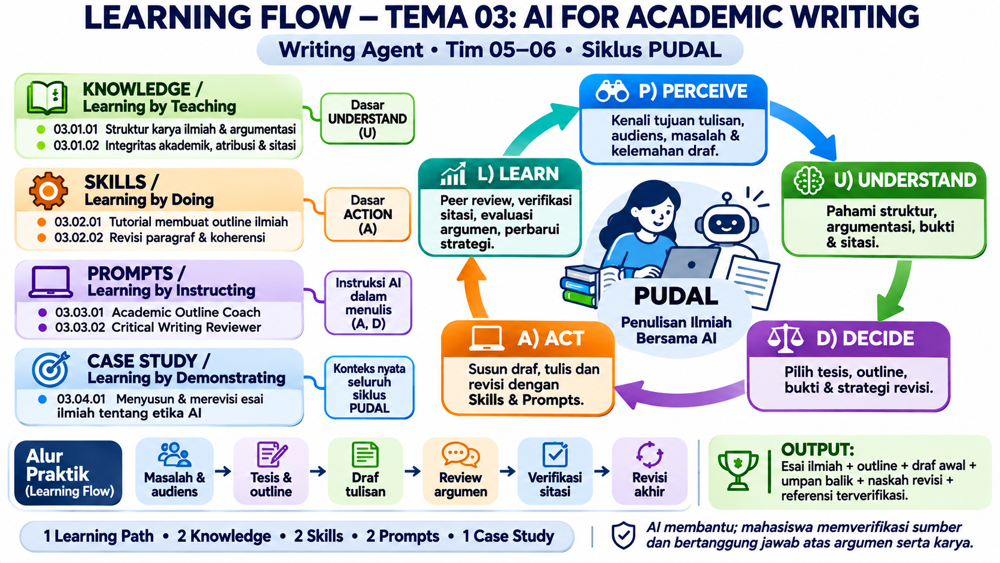
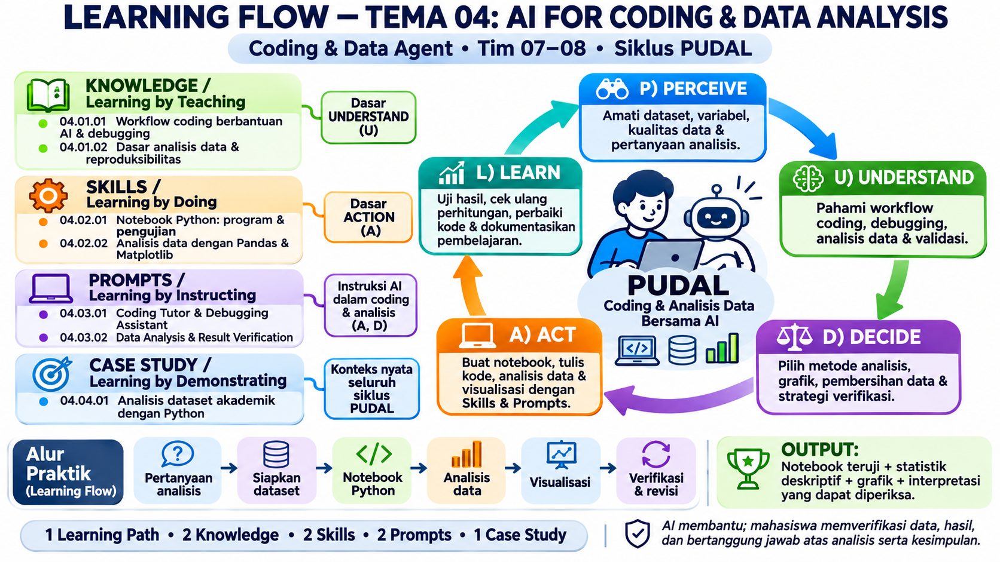
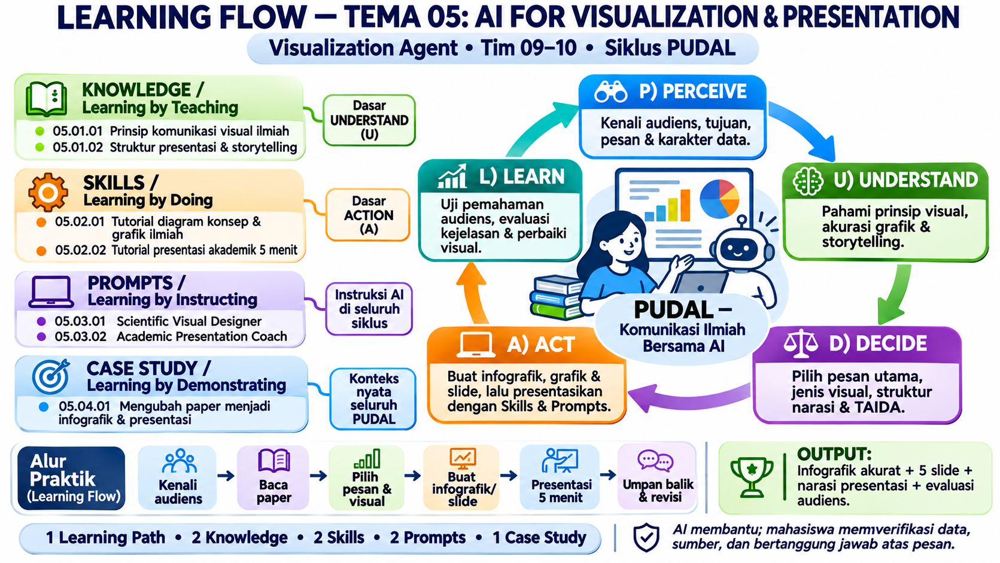
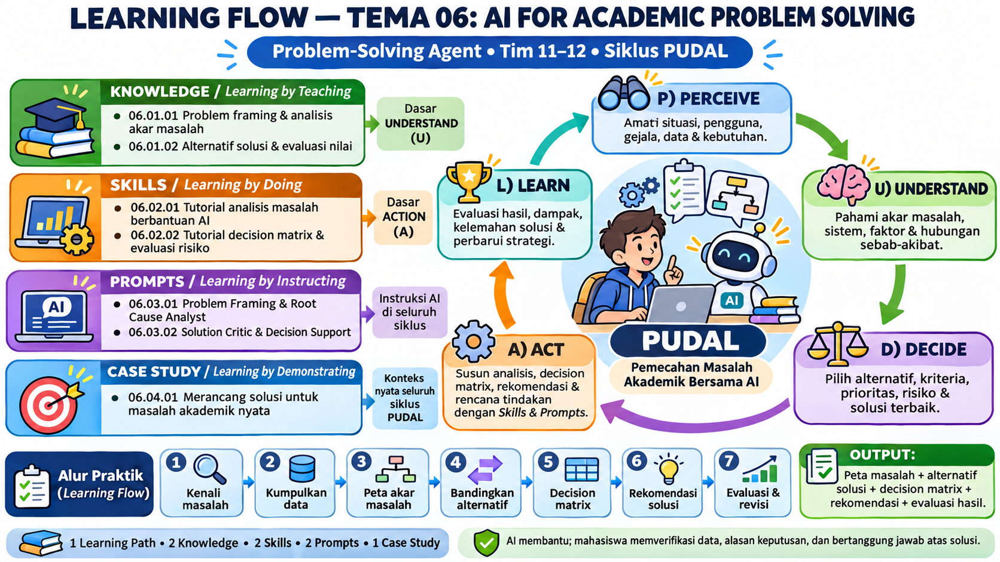

# Enam Learning Paths Berbasis PUDAL

Setiap *Learning Path* dimulai dari Case Study yang memperlihatkan kebutuhan dan kondisi awal, lalu memanfaatkan Knowledge, Skills, dan Prompts untuk menjalankan PUDAL. Case Study menjadi konteks seluruh siklus, bukan hanya tugas penutup. Setiap tema menyajikan demonstrasi lengkap dan tantangan mandiri untuk menguji transfer kemampuan.

## Tema 01 — AI for Learning
**Agen:** Learning Agent · **Kelompok:** 01–02 · **Kasus:** Mempelajari Teorema Bayes.

{#fig-lp1-1 width="100%" fig-align="center"}

| PUDAL | Learning activity |
|---|---|
| Perceive | Kesulitan konsep dan hasil pre-test |
| Understand | Dasar belajar efektif; metakognisi |
| Decide | Pilih penjelasan, contoh, dialog, atau latihan |
| Act | Tutor Socratic; latihan; pemeriksa miskonsepsi |
| Learn | Post-test tanpa menyalin AI; revisi pembelajaran |

**Alur praktik:** Pre-test → Tutor Socratic → Contoh Bayes → Latihan mandiri → Post-test → Revisi.
**Keluaran terverifikasi:** Pemahaman konsep dan kemampuan menyelesaikan soal baru.
**Strategi engine:** Natural untuk penalaran, argumentasi, dan akuntabilitas; instrumental untuk pengolahan, pencatatan, dan visualisasi; vehicular untuk layanan AI terdelegasi dengan pemeriksaan pengguna. Pilih per stage berdasarkan sumber daya serta kemampuan, tidak otomatis mengutamakan AI.
**Milestone:** diagnosis awal → pilihan strategi → demonstrasi kerja → validasi → perbaikan. Bila hasil evaluasi gagal, jalankan ulang Execution PUDAL; bila peta kurang lengkap aktifkan Understanding; bila skill kurang aktifkan Learning.

## Tema 02 — AI for Literature Research
**Agen:** Research Agent · **Kelompok:** 03–04 · **Kasus:** Sintesis lima paper terverifikasi.

{#fig-lp2-1 width="100%" fig-align="center"}

| PUDAL | Learning activity |
|---|---|
| Perceive | Rumusan pertanyaan riset, cakupan, kriteria sumber |
| Understand | Struktur paper, pembacaan kritis dan strategi pencarian |
| Decide | Pilih kata kunci, lima sumber dan metode sintesis |
| Act | Cari, baca, ringkas, matriks, bandingkan literatur |
| Learn | Periksa kutipan dan klaim terhadap sumber asli |

**Alur praktik:** Pertanyaan riset → Cari & seleksi → Baca kritis → Matriks → Sintesis → Verifikasi.
**Keluaran terverifikasi:** Matriks lima paper, sintesis kritis, research gap.
**Strategi engine:** Natural untuk penalaran, argumentasi, dan akuntabilitas; instrumental untuk pengolahan, pencatatan, dan visualisasi; vehicular untuk layanan AI terdelegasi dengan pemeriksaan pengguna. Pilih per stage berdasarkan sumber daya serta kemampuan, tidak otomatis mengutamakan AI.
**Milestone:** diagnosis awal → pilihan strategi → demonstrasi kerja → validasi → perbaikan. Bila hasil evaluasi gagal, jalankan ulang Execution PUDAL; bila peta kurang lengkap aktifkan Understanding; bila skill kurang aktifkan Learning.

## Tema 03 — AI for Academic Writing
**Agen:** Writing Agent · **Kelompok:** 05–06 · **Kasus:** Memperbaiki esai tentang etika AI.

{#fig-lp3-1 width="100%" fig-align="center"}

| PUDAL | Learning activity |
|---|---|
| Perceive | Tujuan tulisan, audiens, kelemahan draf |
| Understand | Struktur argumen, integritas, sitasi |
| Decide | Pilih tesis, outline, bukti dan strategi revisi |
| Act | Membuat outline, draf dan revisi paragraf |
| Learn | Peer review dan verifikasi sitasi |

**Alur praktik:** Masalah & audiens → Tesis & outline → Draf → Review → Verifikasi → Revisi.
**Keluaran terverifikasi:** Esai akhir, outline, umpan balik, jejak revisi.
**Strategi engine:** Natural untuk penalaran, argumentasi, dan akuntabilitas; instrumental untuk pengolahan, pencatatan, dan visualisasi; vehicular untuk layanan AI terdelegasi dengan pemeriksaan pengguna. Pilih per stage berdasarkan sumber daya serta kemampuan, tidak otomatis mengutamakan AI.
**Milestone:** diagnosis awal → pilihan strategi → demonstrasi kerja → validasi → perbaikan. Bila hasil evaluasi gagal, jalankan ulang Execution PUDAL; bila peta kurang lengkap aktifkan Understanding; bila skill kurang aktifkan Learning.

## Tema 04 — AI for Coding & Data Analysis
**Agen:** Coding & Data Agent · **Kelompok:** 07–08 · **Kasus:** Analisis dataset akademik dengan Python.

{#fig-lp4-1 width="100%" fig-align="center"}

| PUDAL | Learning activity |
|---|---|
| Perceive | Dataset, kualitas dan pertanyaan analisis |
| Understand | Workflow coding, debugging, reproduksibilitas |
| Decide | Pilih pembersihan, statistik, algoritma dan grafik |
| Act | Notebook Python, Pandas, Matplotlib |
| Learn | Uji hitung, audit kode, dokumentasi |

**Alur praktik:** Pertanyaan → Siapkan data → Notebook → Analisis → Visualisasi → Verifikasi.
**Keluaran terverifikasi:** Notebook teruji, grafik, statistik dan interpretasi.
**Strategi engine:** Natural untuk penalaran, argumentasi, dan akuntabilitas; instrumental untuk pengolahan, pencatatan, dan visualisasi; vehicular untuk layanan AI terdelegasi dengan pemeriksaan pengguna. Pilih per stage berdasarkan sumber daya serta kemampuan, tidak otomatis mengutamakan AI.
**Milestone:** diagnosis awal → pilihan strategi → demonstrasi kerja → validasi → perbaikan. Bila hasil evaluasi gagal, jalankan ulang Execution PUDAL; bila peta kurang lengkap aktifkan Understanding; bila skill kurang aktifkan Learning.

## Tema 05 — AI for Visualization & Presentation
**Agen:** Visualization Agent · **Kelompok:** 09–10 · **Kasus:** Dari paper ke infografik dan presentasi.

{#fig-lp5-1 width="100%" fig-align="center"}

| PUDAL | Learning activity |
|---|---|
| Perceive | Audiens, tujuan, pesan dan karakter data |
| Understand | Prinsip visual, akurasi grafik, storytelling |
| Decide | Pilih pesan utama, visual dan strategi TAIDA |
| Act | Diagram, infografik, lima slide, presentasi lima menit |
| Learn | Uji pemahaman audiens, cek distorsi, revisi |

**Alur praktik:** Kenali audiens → Baca paper → Pilih pesan → Buat visual → Presentasi → Umpan balik.
**Keluaran terverifikasi:** Infografik akurat, lima slide, narasi, evaluasi audiens.
**Strategi engine:** Natural untuk penalaran, argumentasi, dan akuntabilitas; instrumental untuk pengolahan, pencatatan, dan visualisasi; vehicular untuk layanan AI terdelegasi dengan pemeriksaan pengguna. Pilih per stage berdasarkan sumber daya serta kemampuan, tidak otomatis mengutamakan AI.
**Milestone:** diagnosis awal → pilihan strategi → demonstrasi kerja → validasi → perbaikan. Bila hasil evaluasi gagal, jalankan ulang Execution PUDAL; bila peta kurang lengkap aktifkan Understanding; bila skill kurang aktifkan Learning.

## Tema 06 — AI for Academic Problem Solving
**Agen:** Problem-Solving Agent · **Kelompok:** 11–12 · **Kasus:** Perbaikan masalah layanan akademik.

{#fig-lp6-1 width="100%" fig-align="center"}

| PUDAL | Learning activity |
|---|---|
| Perceive | Gejala, pengguna, kebutuhan, data awal |
| Understand | Problem framing, akar masalah, hubungan sebab-akibat |
| Decide | Pilih alternatif berdasar nilai, risiko dan kapasitas |
| Act | Peta masalah, decision matrix, rekomendasi |
| Learn | Uji skenario dan evaluasi dampak solusi |

**Alur praktik:** Kenali masalah → Data → Peta akar → Alternatif → Matriks → Solusi → Evaluasi.
**Keluaran terverifikasi:** Peta masalah, opsi, matriks keputusan, rekomendasi teruji.
**Strategi engine:** Natural untuk penalaran, argumentasi, dan akuntabilitas; instrumental untuk pengolahan, pencatatan, dan visualisasi; vehicular untuk layanan AI terdelegasi dengan pemeriksaan pengguna. Pilih per stage berdasarkan sumber daya serta kemampuan, tidak otomatis mengutamakan AI.
**Milestone:** diagnosis awal → pilihan strategi → demonstrasi kerja → validasi → perbaikan. Bila hasil evaluasi gagal, jalankan ulang Execution PUDAL; bila peta kurang lengkap aktifkan Understanding; bila skill kurang aktifkan Learning.

## Memasuki learning path berdasarkan diagnosis

Pengguna tidak selalu memulai dari tema pertama. Peserta yang sedang menyusun esai mungkin masuk melalui Writing lalu membutuhkan Research untuk memeriksa bukti. Peserta yang membawa dataset dapat masuk melalui Coding & Data, kemudian membutuhkan Visualization. Halaman masuk perlu menanyakan tujuan dan prasyarat, lalu menyarankan jalur yang relevan. Pengguna tetap dapat melihat alasan saran tersebut dan memilih rute yang sesuai.

Learning path merupakan hubungan aktivitas, sumber, bantuan, dan bukti penguasaan. Daftar tautan belum menjadi jalur belajar jika pengguna tidak tahu kapan berpindah tahap atau bagaimana menilai hasil. Gunakan transisi yang konkret: setelah mampu menjelaskan konsep, lanjut latihan; setelah latihan memenuhi kriteria, coba kasus baru; jika gagal, kembali pada diagnosis yang sesuai.

## Pendalaman Tema 1 dan 2: konsep dan penilaian sumber

Pada Learning, satu kesalahan Bayes dipakai untuk menentukan bantuan. Peserta yang menukar probabilitas mendapat latihan kelompok pembanding; peserta yang memahami konsep tetapi salah menghitung mendapat pemeriksaan aritmetika. Tantangan mandiri memakai konteks spam agar transfer struktur dapat dinilai. Aktivitas mengambil kembali pengetahuan menjadi salah satu pilihan latihan, dengan dukungan terbatas dari riset retrieval practice [@roediger2006].

Pada Literature Research, lima paper merupakan titik mulai praktikum, bukan bukti cakupan lengkap. Pengguna mencatat kata kunci, alasan seleksi, dan lokasi klaim. Tantangan mandiri meminta pengguna menambahkan studi yang tidak sepakat dengan pola awal lalu memperbarui sintesis. PRISMA relevan ketika kegiatan dikembangkan menjadi review sistematis dengan pelaporan yang sesuai [@prisma2020].

## Pendalaman Tema 3 dan 4: argumen dan analisis

Pada Writing, masukan awal dapat berupa tesis yang terlalu luas. Agen meminta penulis memperjelas lingkup dan alasan sebelum menyunting kalimat. Milestone tercapai ketika setiap klaim penting mempunyai bukti dan hubungan penalaran yang dapat dijelaskan. Tantangan berikutnya adalah menghadapi keberatan kuat, bukan sekadar memperpanjang tulisan. Kerangka argumen membantu memisahkan bukti dari penghubungnya [@purdue-toulmin].

Pada Coding & Data, pengguna memulai dengan unit observasi dan pertanyaan. Tutorial memakai data kecil yang dapat diperiksa manual sebelum skala diperbesar. Milestone teknis berupa skrip yang dapat dijalankan ulang; milestone interpretasi berupa penjelasan apa yang tidak dapat disimpulkan. Tantangan mandiri memasukkan duplikasi kunci atau nilai kosong agar pengguna mendiagnosis masalah, bukan hanya menjalankan notebook.

## Pendalaman Tema 5 dan 6: representasi dan negosiasi

Pada Visualization, pengguna menulis pesan utama dan VKS sebelum membuat layout. Reviewer menelusuri angka ke sumber dan menguji apakah pembaca memahami relasi. Tantangan mandiri mengubah audiens dari teman sekelas menjadi pembaca umum, sehingga pengguna perlu menyederhanakan tanpa mengubah makna. Prinsip representasi ketidakpastian dan warna memberi bahan pemeriksaan [@wilke2019].

Pada Problem Solving, pengguna memisahkan gejala, kebutuhan, dan usulan solusi. Matriks keputusan dibuat setelah batas wajib ditentukan. Tantangan mandiri mengubah satu kendala, misalnya akses data hilang atau tenggat dipercepat. Peserta harus memperbarui rute dengan alasan, bukan mempertahankan skor lama. Hasilnya dinilai dari kelayakan dan kemampuan mempertanggungjawabkan trade-off.

## Menghubungkan keenam jalur menjadi satu proyek

Satu proyek integratif dapat dimulai dari masalah kesulitan belajar probabilitas. Research memetakan bukti, Learning merancang latihan, Writing menyusun argumentasi desain, Coding & Data menganalisis hasil pilot, Visualization mengomunikasikan temuan, dan Problem Solving mengelola kebutuhan pihak terkait. Urutan ini hanya salah satu kemungkinan; setiap handoff perlu menjaga sumber dan batas klaim.

Untuk latihan, pilih dua tema yang berdekatan lalu tulis apa yang diserahkan dari tema pertama dan apa yang diuji tema kedua. Jika keduanya hanya bertukar berkas tanpa kriteria, perjelas kontraknya. Jalur belajar menjadi bermakna ketika kemajuan dapat terlihat dari kemampuan pengguna, selain dari banyaknya materi yang telah dibuka.
