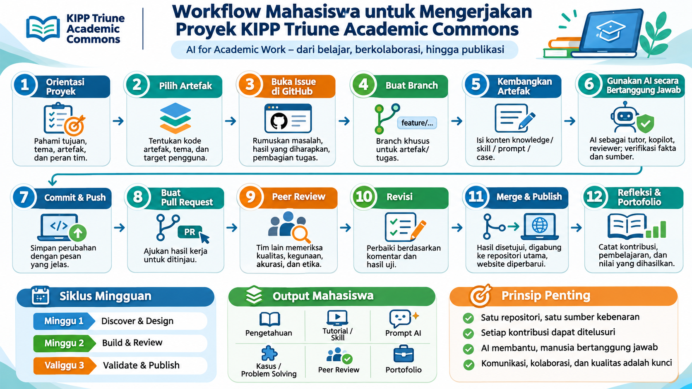

# UAS sebagai Proyek Triune Academic Commons

## Tantangan untuk mahasiswa

**Misi 21 hari:** 60+ mahasiswa dalam **12 kelompok** mengembangkan **6 AI Academic Agents**, **6 Learning Paths**, dan **42 artefak akademik** yang dapat dipakai mahasiswa lain. Nilai proyek bukan hanya dari jumlah berkas, melainkan dari manfaat, kualitas, pengujian, dan kemampuan bekerja sama.

{#fig-flow-1 width="100%" fig-align="center"}

## TAIDA sebagai desain motivasi dan mobilisasi

- **Target:** mahasiswa sebagai pencipta dan penerima manfaat; perubahan dari konsumen jawaban AI menjadi pelaku yang paham dan mampu.
- **Attention:** karya akademik dapat hidup melampaui akhir semester.
- **Interest:** tiap tema menyediakan alat dan kasus yang relevan dengan pekerjaan nyata.
- **Desire:** ada portofolio GitHub, kompetensi baru, kontribusi kolektif, dan pengakuan berbasis hasil.
- **Action:** bergabung dalam tim, menerima tanggung jawab, menyusun artefak, melakukan review, mempublikasikan bukti.

## Pembagian tugas

Tim 01–02 mengembangkan AI for Learning, 03–04 Literature Research, 05–06 Academic Writing, 07–08 Coding & Data, 09–10 Visualization & Presentation, dan 11–12 Problem Solving. Setiap tim menghasilkan Knowledge, Skill, Prompt; dua tim satu tema bersama menghasilkan Case Study dan Learning Path. Pembagian rinci ada pada Lampiran A dan file Excel `data/KIPP_Pembagian_Kelompok_dan_42_Artefak.xlsx`.

## Tiga minggu dengan decision gates

| Waktu | Fokus | Bukti checkpoint |
|---|---|---|
| Minggu 1 | Kenali pengguna, rumuskan masalah, Knowledge | 12 Knowledge awal; peta masalah dan tujuan |
| Minggu 2 | Skills, Prompts, eksperimen | 12 Skills dan 12 Prompts teruji |
| Minggu 3 | Case Studies, showcase, evaluasi | 6 kasus lengkap, 6 paket agen, perbaikan akhir |

## Bukti individual dan kolektif

Individu mengumpulkan kontribusi konkret, proses belajar, keputusan yang diambil, ulasan yang diberikan, serta refleksi. Tim membuktikan kualitas tiga artefak. Pasangan tim membuktikan integrasi Case Study dan Learning Path, termasuk keputusan engine, kendala sumber daya, dan satu siklus PUDAL penuh. Review lintas tim diperlukan untuk menilai kemudahan penggunaan dan integritas materi.

## Rubrik usulan, belum ditetapkan

| Dimensi | Bobot usulan |
|---|---:|
| Komunikasi dan TAIDA | 25% |
| Kontribusi artefak individual | 25% |
| Kolaborasi dan peer review | 20% |
| Learning Path, Case Study, dan agen | 20% |
| Refleksi serta integritas AI | 10% |

Bobot dan kebijakan final mengikuti keputusan resmi pengampu. Tidak ada kewajiban membuat model AI baru atau membeli layanan AI berbayar.

## Memulai proyek dengan kesepakatan kerja

Pada hari pertama, pasangan kelompok menyepakati pengguna sasaran, kasus, keluaran minimum, dan cara penerimaan. Pembagian tugas sebaiknya mengikuti fungsi dan saling bergantung secara wajar. Satu anggota dapat memegang kurasi sumber, tetapi anggota lain tetap harus memahami sumber utama. Satu anggota memegang integrasi, tetapi tidak menjadi satu-satunya orang yang dapat menjalankan paket.

Tuliskan kontrak kerja yang mencakup jadwal komunikasi, lokasi berkas, aturan perubahan, cara memberi review, dan penyelesaian hambatan. Kesepakatan ini melindungi anggota yang bekerja di waktu berbeda serta mencegah keputusan penting tersimpan hanya dalam percakapan pribadi. Jika anggota menghadapi kendala, tim memperbarui pembagian kerja dan menyimpan alasan.

## Minggu pertama: menguji satu irisan lengkap

Daripada menulis seluruh Knowledge lebih dahulu, buat satu irisan kecil dari konsep sampai contoh penggunaan. Untuk tema Bayes, irisan itu mencakup penjelasan penyebut, tutorial tabel, satu prompt tutor, dan satu catatan kasus. Pengguna lain mencoba irisan tersebut. Hasil uji menunjukkan apakah rancangan dasar layak sebelum setiap kelompok memperluas artefaknya.

Gate minggu pertama memeriksa pertanyaan pengguna, kebenaran konsep inti, keterlacakan sumber, dan kelayakan rencana. Draf yang panjang tetapi belum menjawab pengguna tidak otomatis lolos. Jika kebutuhan terlalu luas, kurangi lingkup saat biaya perubahan masih rendah. Tetapkan pemilik tindakan untuk kekurangan yang ditemukan.

## Minggu kedua: pengujian antarpenyusun

Setiap tutorial dijalankan anggota yang tidak menulisnya. Setiap prompt dicoba pada masukan yang tidak dipakai saat pengembangan. Knowledge diperiksa oleh pembaca yang diminta menerangkan ulang konsep. Uji ini mengungkap asumsi tersirat dan variasi perilaku AI. Catat versi alat atau layanan ketika relevan, karena keluaran dapat berubah.

Jangan menunggu semua berkas selesai untuk integrasi. Hubungkan artefak sejak awal melalui ID dan prasyarat. Jika tutorial mengacu pada istilah yang tidak ada di Knowledge, perbaiki hubungan tersebut. Jika prompt mengasumsikan dataset yang tidak boleh dibagikan, sediakan alternatif yang sah atau ubah lingkup demonstrasi.

## Minggu ketiga: membuktikan hasil dan kontribusi

Showcase menampilkan satu perjalanan pengguna dari A sampai bukti B. Presentasi perlu menunjukkan keputusan yang berubah setelah pengujian, selain produk akhir. Reviewer memilih satu klaim, satu langkah tutorial, dan satu perilaku prompt untuk diperiksa. Demonstrasi yang gagal tidak ditutupi dengan video lama; jelaskan versi, penyebab, dan perbaikan yang masih diperlukan.

Kontribusi individual dapat berupa analisis sumber, perbaikan tutorial, diagnosis bug, review yang mengubah rancangan, atau penjelasan konsep. Bukti volume seperti jumlah commit dipakai sebagai petunjuk proses, bukan ukuran tunggal mutu. Minta setiap anggota mempertahankan satu keputusan penting dan mengerjakan tantangan pendek yang relevan.

## Menilai tanpa menghilangkan tujuan komunikasi

Mata kuliah KIPP memerlukan bukti komunikasi: memahami penerima, membuat pesan yang relevan, mendengarkan umpan balik, serta berkoordinasi secara bertanggung jawab. Produk AI menjadi konteks praktik keterampilan tersebut. Tujuan dan asesmen perlu selaras [@cmu-alignment], sehingga kecanggihan teknis tidak boleh menggantikan seluruh penilaian komunikasi.

Bobot pada bab ini tetap usulan dan tidak mengubah ketentuan resmi. Tim perlu merujuk arahan pengampu untuk keputusan penilaian. Sebagai latihan perencanaan, susun daftar pekerjaan wajib, pekerjaan tambahan, dan pekerjaan yang dapat dibatalkan jika kapasitas turun. Jelaskan bukti minimum yang tetap dijaga. Kejelasan ini membantu proyek selesai dengan mutu yang dapat diperiksa tanpa menggantungkan keberhasilan pada penambahan jam kerja di akhir.
