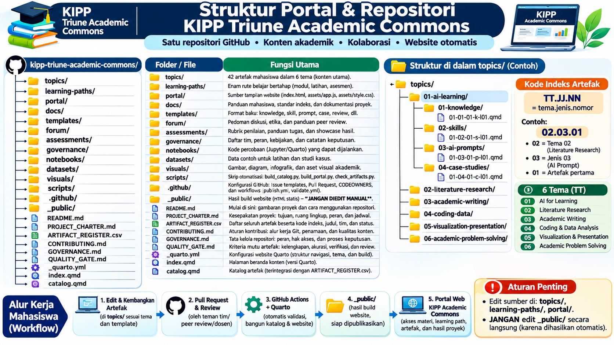

# Repositori, Portal, dan Workflow Kolaboratif

## Satu portal, satu repositori bersama

Portal proyek disimpan di repositori publik [azral1962/kipp-triune-academic-commons](https://github.com/azral1962/kipp-triune-academic-commons), dengan branch utama `main`. Repositori ini menjadi sumber bersama untuk beranda portal, enam tema, katalog 42 artefak, enam learning path, panduan proyek, dan otomatisasi penerbitan. Mahasiswa mengerjakan sumber yang tersedia melalui Issue dan Pull Request; forum akademik menggunakan GitHub Discussions.

Uraian implementasi pada bab ini mengacu pada pemeriksaan **23 November 2026**, terhadap commit [`c591a6a`](https://github.com/azral1962/kipp-triune-academic-commons/tree/c591a6a2dd1084063b049189d20e34a0ad3dda94). Saat diperiksa, seluruh 42 artefak masih berstatus `draft` dan memiliki penanda `[ISI]`; enam learning path juga masih berupa kerangka. Karena itu, jumlah berkas menunjukkan kesiapan wadah kerja, belum membuktikan penyelesaian materi akademik. Lingkup pilot, aturan kontribusi, dan keadaan awal dijelaskan dalam [README portal](https://github.com/azral1962/kipp-triune-academic-commons/blob/main/README.md).

{#fig-repository-1 width="100%" fig-align="center"}


## Penomoran artefak

Repositori menggunakan dua penanda yang saling melengkapi: **ID tetap**, seperti `P-R01`, dan **kode hierarkis TT.JJ.NN**, seperti `02.03.01`. TT menyatakan tema, JJ menyatakan jenis (01 Knowledge, 02 Skills, 03 AI Prompts, 04 Case Studies), dan NN menyatakan urutan. ID tetap dipakai untuk melacak tugas, diskusi, dan kontribusi; kode hierarkis menjelaskan susunan artefak. Keduanya tetap disimpan pada metadata dan registri.

Contoh nyata adalah **Critical Paper Reader**, milik Tim 03: ID `P-R01`, kode `02.03.01`, dan path `topics/02-literature-research/03-ai-prompts/02-03-01-p-r01.qmd`. ID tersebut tidak diganti menjadi kode numerik. Standar serta aturan pemindahan berkas tersedia pada [standar indeks repositori](https://github.com/azral1962/kipp-triune-academic-commons/blob/main/docs/INDEX-CODING-STANDARD.md).

## Struktur folder repositori portal

```text
kipp-triune-academic-commons/
  README.md
  CONTRIBUTING.md
  PROJECT_CHARTER.md
  GOVERNANCE.md
  QUALITY_GATE.md
  LICENSE-DECISION.md
  _quarto.yml
  index.qmd
  catalog.qmd
  ARTIFACT_REGISTER.csv
  portal/
    index.html
    assets/
      app.js
      style.css
  topics/
    01-ai-learning/
      01-knowledge/
      02-skills/
      03-ai-prompts/
      04-case-studies/
    02-literature-research/
    03-academic-writing/
    04-coding-data/
    05-visualization-presentation/
    06-academic-problem-solving/
  learning-paths/
  forum/
  docs/                     # panduan proyek dan Git/GitHub
  templates/
  assessments/
  governance/
  datasets/
  notebooks/
  visuals/
  scripts/
    check_artifacts.py
    check_portal.py
    build_catalog.py
    build_portal.py
  .github/
    CODEOWNERS
    ISSUE_TEMPLATE/
    pull_request_template.md
    workflows/
      validate.yml
      publish.yml
  _site/                    # dihasilkan oleh Quarto
  _public/                  # paket akhir hasil build portal
```

Folder tema dan jenis sudah memakai penomoran pada struktur di atas. `_site/` dan `_public/` merupakan keluaran build, bukan tempat mahasiswa mengisi materi. Folder `agents/` belum ada pada versi yang diperiksa; gagasan enam agen pada rancangan proyek tidak boleh dibaca sebagai enam implementasi perangkat lunak yang sudah tersedia.

Setiap tema memiliki tujuh artefak: dua Knowledge, dua Skills, dua Prompts, dan satu Case Study. Pasangan Tim 01–02 sampai Tim 11–12 mengembangkan enam tema secara berurutan. Pembagian ID, prioritas, dan penanggung jawab dibaca dari [ARTIFACT_REGISTER.csv](https://github.com/azral1962/kipp-triune-academic-commons/blob/main/ARTIFACT_REGISTER.csv); daftar asli dalam buku tetap menjadi jejak historis, sedangkan pekerjaan portal mengikuti registri portal terkini.

## Kolaborasi GitHub: dari tugas sampai artefak terverifikasi

{#fig-github-1 width="100%" fig-align="center"}


**Issue → Branch → Edit dan Uji → Commit → Push → Pull Request → Peer Review lintas tim → Revisi → Merge → Publish.** Issue menyatakan tujuan dan kriteria penerimaan; PR membuktikan perubahan serta pengujian; reviewer memeriksa isi, referensi, dan keterpakaian. Dalam konvensi metadata repositori, hasil yang sudah melewati review serta uji dicatat sebagai `reviewed`. Istilah *terverifikasi* pada pembahasan mutu menjelaskan proses pemeriksaan, bukan nilai metadata baru bernama `verified`.

Dalam Academic Commons, alur tersebut menghubungkan pekerjaan 12 kelompok dengan mutu 42 artefak. Satu perubahan sebaiknya cukup kecil untuk diperiksa secara utuh. Langkah di bawah menerapkan [panduan kontribusi portal](https://github.com/azral1962/kipp-triune-academic-commons/blob/main/CONTRIBUTING.md) dengan contoh `P-R01`. Nomor Issue pada contoh tetap ilustratif. Panduan mahasiswa yang lebih rinci tersedia di [docs/student-workflow.md](https://github.com/azral1962/kipp-triune-academic-commons/blob/main/docs/student-workflow.md), sedangkan pola branch mengikuti [GitHub flow](https://docs.github.com/en/get-started/using-github/github-flow).

### Memahami Git, GitHub, dan istilah dasarnya

**Git** mencatat versi berkas dan riwayat perubahan pada komputer. **GitHub** menyediakan tempat menyimpan repositori secara daring, membahas pekerjaan, meninjau perubahan, dan menerbitkan portal. Menyimpan berkas di komputer belum berarti perubahan tersebut sudah tersedia bagi anggota lain.

| Istilah | Arti praktis dalam proyek |
|---|---|
| Repository atau repositori | Wadah sumber portal, artefak, registri, dan riwayat perubahan |
| Clone | Membuat salinan lokal repositori beserta riwayat Git |
| Branch | Jalur kerja untuk mengembangkan perubahan sebelum digabung |
| Commit | Rekaman perubahan terpilih dengan pesan dan identitas penulis |
| Push | Mengirim commit lokal ke repositori daring |
| Pull | Mengambil dan mengintegrasikan perubahan dari repositori daring |
| Issue | Catatan masalah atau tugas, beserta pembahasan dan kriteria penerimaannya |
| Pull Request atau PR | Usulan menggabungkan perubahan antarbranch untuk ditinjau |
| Merge | Menggabungkan perubahan suatu branch ke branch tujuan |
| Fork | Salinan repositori di akun lain untuk kontribusi tanpa akses tulis ke repositori asal |

Branch utama portal bernama `main`. Mengunggah berkas, menggabungkan PR, dan menerbitkan portal adalah tiga kejadian berbeda; keberhasilan salah satunya tidak membuktikan dua lainnya berhasil. Discussions digunakan untuk pertanyaan atau pembahasan akademik, Issues untuk pekerjaan konkret, dan PR untuk perubahan berkas yang akan diintegrasikan.

### Persiapan akun, repositori, dan pembagian peran

Gunakan repositori `azral1962/kipp-triune-academic-commons` yang sudah tersedia. Koordinator mengatur akses anggota, mengisi `governance/team-roster.csv`, dan mencatat keputusan dalam `governance/decision-log.md`. `PROJECT_CHARTER.md` masih ditandai draf dan `LICENSE-DECISION.md` menyatakan lisensi belum dipilih pada versi yang diperiksa. Pengampu dan perwakilan mahasiswa perlu mengesahkan kesepakatan proyek serta hak publikasi karya.

Setiap anggota perlu dapat masuk ke GitHub, menerima undangan akses, menemukan repositori, dan membuka Issue. Aktifkan autentikasi dua faktor serta simpan kode pemulihan dengan aman. Jalur lokal memerlukan Git, editor, Python 3.10 atau lebih baru, serta Quarto untuk preview lengkap; workflow CI memakai Python 3.12. GitHub Desktop dapat menjadi pilihan antarmuka grafis. Akses Git melalui HTTPS menggunakan mekanisme kredensial seperti token atau pengelola kredensial; kata sandi akun bukan pengganti token untuk operasi Git. Alternatifnya adalah SSH. Ikuti [dokumentasi autentikasi GitHub](https://docs.github.com/en/authentication/keeping-your-account-and-data-secure/about-authentication-to-github) sesuai metode yang dipilih.

| Peran kerja | Tanggung jawab utama |
|---|---|
| Koordinator repositori | Mengatur akses, aturan branch, dan penyelesaian hambatan integrasi |
| Kontributor | Mengembangkan sumber, menguji perubahan, dan menanggapi review |
| Reviewer lintas kelompok | Memeriksa ketepatan isi dan mencoba artefak dari sudut pengguna |
| Integrator/pengelola rilis | Memastikan perubahan yang diterima dapat dibangun dan diterbitkan bersama |

Peran kerja ini tidak otomatis sama dengan nama tingkat izin GitHub. Berikan hak akses sesuai kebutuhan; seluruh anggota tidak perlu menjadi administrator. Kontributor sebaiknya tidak menjadi satu-satunya penilai perubahan sendiri. Sepakati minimal satu reviewer dari luar penyusun artefak sebelum merge.

`README.md`, `CONTRIBUTING.md`, `GOVERNANCE.md`, dan `QUALITY_GATE.md` sudah tersedia sebagai panduan kerja. Aturan kontribusi menggunakan pola branch `tim-XX/ID-deskripsi` dan meminta satu reviewer dari tim lain. `.github/CODEOWNERS` masih berisi contoh akun yang dikomentari; keberadaannya belum berarti reviewer otomatis telah ditetapkan. Pengelola perlu memeriksa akun pemilik, izin, serta kewajiban review pada pengaturan branch. Mekanisme pembatasannya dijelaskan dalam [aturan protected branches](https://docs.github.com/en/repositories/configuring-branches-and-merges-in-your-repository/managing-protected-branches/about-protected-branches).

### Merumuskan pekerjaan melalui Issue

Di repositori, buka **Issues → New issue**. Cari dahulu apakah masalah yang sama sudah dilaporkan. Pilih formulir **Tugas artefak**, yang disediakan dalam `.github/ISSUE_TEMPLATE/artifact-task.yml`. Formulir meminta ID artefak, tim, sasaran pengguna dan ukuran sukses, serta pekerjaan dan bukti uji. Untuk laporan masalah mutu, tersedia formulir `quality-report.yml`. Contoh pengisian tugas berikut memakai artefak yang benar-benar tersedia; isi pekerjaan merupakan rancangan latihan.

```text
Judul: [P-R01 | 02.03.01] Isi dan uji Critical Paper Reader

Masalah pengguna:
Mahasiswa memerlukan bantuan membaca paper tanpa menerima sumber karangan AI.

Lingkup perubahan:
Isi prompt, contoh aktual, pengujian, batasan, dan catatan review.

Lokasi:
topics/02-literature-research/03-ai-prompts/02-03-01-p-r01.qmd

Kriteria penerimaan:
- [ ] Tujuan, pengguna, dan bahan masukan prompt dinyatakan.
- [ ] Dua contoh normal dan satu contoh bermasalah dicoba.
- [ ] Klaim keluaran diperiksa terhadap paper sumber.
- [ ] Reviewer lintas tim dan pengguna uji memberi umpan balik.
- [ ] Halaman dapat dirender dan tautan terkait berfungsi.

Tim penanggung jawab: Tim 03; tetapkan satu anggota koordinator tugas
Reviewer: anggota dari kelompok lain
Bukti yang diminta: input-output aktual, sumber, catatan uji, dan hasil render
```

Formulir tugas mencantumkan label `artifact`; pengelola memastikan label tersebut tersedia. Label tambahan, milestone minggu 1–3, dan papan Projects dapat disepakati untuk koordinasi. Jika dipakai, kolom seperti **Direncanakan → Dikerjakan → Direview → Perlu revisi → Diterima** merupakan alat perencanaan tim. Kolom itu tidak otomatis mengubah nilai `status` pada YAML dan CSV.

### Jalur pemula: menyunting melalui browser

Untuk koreksi teks singkat, anggota yang memiliki akses tulis dapat bekerja tanpa memasang Git lokal:

1. Buka repositori dan pastikan branch awal adalah `main` yang terbaru.
2. Buat branch dengan nama yang menjelaskan tugas, misalnya `tim-03/P-R01-critical-reader`.
3. Pada branch tersebut, buka `topics/02-literature-research/03-ai-prompts/02-03-01-p-r01.qmd` dan pilih penyuntingan. Isi bagian `[ISI]`, pertahankan metadata, lalu periksa diff, yaitu perbandingan sebelum dan sesudah perubahan.
4. Simpan sebagai commit pada branch kerja dengan pesan yang spesifik, misalnya `docs(P-R01): isi dan uji Critical Paper Reader`.
5. Buka PR menuju `main`, hubungkan Issue, dan minta review. Jika belum siap, gunakan draft PR.
6. Jika reviewer meminta revisi, sunting dan commit kembali pada branch yang sama agar PR memuat revisi tersebut.

Jika tidak memiliki akses tulis, gunakan fork sesuai kebijakan pengelola, lalu ajukan PR dari branch pada fork ke repositori asal. Pemilihan branch sumber dan tujuan dijelaskan dalam [panduan membuat Pull Request](https://docs.github.com/en/pull-requests/how-tos/create-pull-requests/creating-a-pull-request).

Pratinjau Markdown di GitHub belum membuktikan bahwa sitasi, penomoran gambar, dan navigasi Quarto bekerja. Untuk perubahan melalui browser, minta anggota yang mempunyai lingkungan lokal atau pipeline otomatis melakukan render sebelum PR diterima.

### Jalur GitHub Desktop

Panduan portal juga menyediakan jalur tanpa perintah terminal. Di GitHub Desktop, pilih **File → Clone repository** untuk repositori proyek, perbarui `main` melalui **Fetch origin/Pull origin**, lalu buat branch lewat **Current Branch → New Branch**. Sunting `.qmd` pada editor, periksa perubahan di Desktop, tulis pesan commit, kemudian pilih **Publish branch** atau **Push origin**. Lanjutkan melalui **Preview Pull Request/Create Pull Request**. Revisi tetap dikirim dari branch PR yang sama; render dan pemeriksaan Python dilakukan oleh anggota yang menyiapkan lingkungan lokal.

### Jalur lokal: clone, branch, commit, dan push

Jalur lokal cocok untuk perubahan banyak berkas, gambar, atau contoh yang perlu dijalankan. Contoh berikut menggunakan terminal PowerShell dan akses tulis ke repositori portal. Jalankan di salinan **repo portal**, yang terpisah dari repo sumber buku ini.

Tetapkan identitas commit sekali pada komputer yang digunakan. Alamat surel dapat memakai alamat privat `noreply` yang disediakan dalam pengaturan akun GitHub.

```powershell
git config --global user.name "Nama Mahasiswa"
git config --global user.email "ALAMAT-EMAIL-COMMIT"
git clone https://github.com/azral1962/kipp-triune-academic-commons.git
cd kipp-triune-academic-commons
git status
```

`clone` cukup dilakukan sekali untuk satu salinan lokal. Pada pekerjaan berikutnya, masuk ke folder repositori yang sudah ada. Sebelum memulai tugas baru, pastikan `git status` menunjukkan tidak ada perubahan lokal yang belum diselesaikan, kemudian perbarui `main` dan buat branch:

```powershell
git switch main
git pull --ff-only origin main
git switch -c tim-03/P-R01-critical-reader
```

Sunting sumber `P-R01` yang ditunjuk registri. Pertahankan `id`, `index_code`, `type`, `theme`, `owner`, dan `priority`; jelaskan bantuan AI pada `ai_usage`. Saat artefak belum disetujui, pertahankan `status: draft`. Setelah menyimpan, jalankan pemeriksaan yang tersedia:

```powershell
git status
git diff
python scripts/check_artifacts.py
python scripts/check_portal.py
python scripts/build_catalog.py
git diff -- catalog.qmd
quarto render
```

Periksa halaman hasil di `_site/`; untuk menguji beranda bersama seluruh materi, ikuti langkah perakitan `_public/` pada bagian penerbitan. Periksa sumber, contoh keluaran AI, tautan, dan navigasi. Perintah render tidak otomatis menguji kebenaran isi atau kegunaan prompt. Jika satu perintah gagal, perbaiki kegagalannya sebelum menganggap rangkaian pemeriksaan selesai.

Pilih hanya berkas yang terkait tugas. Untuk contoh `P-R01`, gunakan path yang benar-benar ada pada repo portal:

```powershell
git add topics/02-literature-research/03-ai-prompts/02-03-01-p-r01.qmd
git diff --staged
git commit -m "docs(P-R01): isi dan uji Critical Paper Reader"
git push -u origin tim-03/P-R01-critical-reader
```

`git add` memilih perubahan yang akan direkam; `git diff --staged` memeriksa pilihan itu sebelum commit. Jika status atau data registri berubah dengan persetujuan koordinator, sertakan pula `ARTIFACT_REGISTER.csv` dan hasil pembaruan `catalog.qmd`. `_site/` serta `_public/` dihasilkan ulang untuk penerbitan. `push` mengirim branch kerja; perubahan belum masuk `main` sampai PR digabung.

### Menulis Pull Request yang dapat diperiksa

Di GitHub, pilih **Compare & pull request**, atau buat PR dari menu **Pull requests**. Pastikan **base** adalah `main` dan **compare** adalah branch kerja. Template `.github/pull_request_template.md` sudah meminta ID, tim, prioritas, pemeriksaan mutu, temuan, dan tautan terkait. Lengkapi template tersebut dengan bukti yang konkret, misalnya:

```text
Artefak: P-R01 | 02.03.01 | Critical Paper Reader
Tim pembuat: Tim 03
Prioritas: P1

Masalah dan perubahan:
Kerangka awal belum memuat contoh penggunaan dan hasil uji.
PR mengisi prompt, dua uji normal, satu uji bermasalah, dan batasan.

Artefak dan berkas:
Cantumkan ID registri, path sumber, dan halaman yang terdampak.

Pemeriksaan:
- [ ] check_artifacts.py dan check_portal.py berhasil.
- [ ] Katalog diperbarui bila data registri berubah.
- [ ] Render HTML berhasil; perintah dan versi Quarto dicatat.
- [ ] Klaim keluaran diperiksa terhadap paper sumber.
- [ ] Tautan, gambar, sitasi, dan tampilan diperiksa.
- [ ] Uji pembaca dicatat, termasuk kekurangan yang ditemukan.

Bukti:
Cantumkan tautan preview atau lokasi catatan hasil uji.

Keterbatasan:
Tuliskan hal yang belum diuji atau masih membutuhkan tindak lanjut.

Closes #27
```

Ganti `#27` dengan Issue sebenarnya. Kata kunci `Closes` dapat menutup Issue terkait ketika PR masuk ke branch default; gunakan `Refs #27` jika PR baru menyelesaikan sebagian pekerjaan. Jangan mencentang pemeriksaan yang belum dijalankan. Bedakan hasil yang diamati dari rencana pengujian.

### Melakukan peer review, revisi, dan merge

Reviewer membaca tujuan Issue, memeriksa **Files changed**, lalu mencoba hasil perubahan. Untuk artefak akademik, gunakan checklist berikut sebagai bukti penerimaan:

- **Ketepatan:** konsep, angka, contoh, dan kesimpulan konsisten.
- **Sumber:** rujukan dapat ditelusuri dan mendukung klaim yang dibuat.
- **Keterpakaian:** langkah dapat diikuti pembaca yang tidak ikut menyusunnya.
- **Integrasi:** ID, registri, prasyarat, dan tautan antarartefak sesuai.
- **Tampilan:** rumus, tabel, gambar, dan navigasi terbaca pada halaman hasil.
- **Integritas:** hak penggunaan materi jelas dan bantuan AI diungkap sesuai ketentuan kelas.

Komentar review menyebut lokasi, masalah, dan hasil yang diharapkan, misalnya: “Pada contoh keluaran P-R01, simpulan ini belum dirujuk ke bagian paper. Tunjukkan bagian sumber atau tandai klaim sebagai belum terverifikasi.” Pisahkan koreksi yang harus diselesaikan dari saran pengayaan. Gunakan `templates/peer-review.md` dan `templates/user-test.md` untuk menyimpan bukti. Kontributor memperbaiki branch yang sama; reviewer memeriksa revisi sebelum menyatakan persetujuan.

Koordinator melakukan merge setelah kriteria penerimaan, review lintas tim, uji pengguna, dan pemeriksaan yang diwajibkan terpenuhi. Perubahan status mengikuti prosedur YAML–CSV–katalog pada bagian registri. Sesudah merge, perbarui salinan lokal dengan `git switch main` lalu `git pull --ff-only origin main`. Catat tautan PR pada bagian peer review artefak dan laporan kontribusi; registri saat ini tidak mempunyai kolom khusus URL PR.

### Menyinkronkan pekerjaan dan menyelesaikan konflik

Konflik dapat terjadi ketika dua branch mengubah bagian berkas yang sama. Kurangi risikonya dengan pembagian lingkup, PR berukuran kecil, dan pembaruan dari `main`. Sebelum sinkronisasi, selesaikan atau simpan perubahan lokal dan periksa `git status`. Pada branch kerja, integrasikan versi terbaru:

```powershell
git switch tim-03/P-R01-critical-reader
git fetch origin
git merge origin/main
```

Jika Git melaporkan konflik, buka berkas yang disebut oleh `git status`. Kenali tiga penanda berikut:

| Penanda dalam berkas | Makna pada contoh merge ini |
|---|---|
| `<<<<<<< HEAD` | Awal bagian isi dari branch kerja |
| `=======` | Pemisah antara isi branch kerja dan isi dari `main` |
| `>>>>>>> origin/main` | Akhir bagian isi dari `main` yang sedang digabungkan |

Diskusikan makna perubahan dengan penyusunnya, susun isi akhir yang benar, lalu hapus seluruh penanda konflik. Jangan sekadar memilih satu sisi jika kedua sisi memuat informasi penting. Setelah itu, pilih berkas yang telah diselesaikan dengan `git add NAMA-BERKAS`, jalankan render dan pemeriksaan isi, selesaikan merge dengan `git commit`, lalu `git push`. Jika perlu membatalkan proses merge yang sedang berkonflik untuk meninjau ulang, gunakan `git merge --abort`. Langkah teknisnya tersedia dalam [panduan penyelesaian konflik GitHub](https://docs.github.com/en/pull-requests/how-tos/merge-and-close-pull-requests/resolving-a-merge-conflict-using-the-command-line).

Jika `push` ditolak karena branch daring telah berubah, ambil dan periksa perubahan rekan sebelum mengintegrasikannya. Hindari `push --force` pada branch bersama. Untuk keluaran HTML yang berkonflik, selesaikan sumber lebih dahulu lalu render ulang agar hasil mengikuti sumber yang telah disepakati.

### Menjaga berkas, data, dan bukti kontribusi

Simpan sumber, gambar yang diperlukan, bibliografi, dan data yang boleh dibagikan. Gunakan `.gitignore` untuk berkas sementara, lingkungan lokal, atau kredensial seperti `.env`. Berkas yang sudah dilacak Git tetap terlacak meskipun kemudian dimasukkan ke `.gitignore`; periksa riwayat dan daftar perubahan sebelum mengunggah.

Jangan menaruh token, kata sandi, data pribadi mahasiswa, atau dokumen berlisensi terbatas di repositori publik. Jika token terlanjur terbuka, segera cabut atau rotasi token tersebut; menghapusnya dari versi terbaru saja tidak menghapus riwayat. Untuk materi pihak ketiga, catat sumber dan izin penggunaan. Lisensi repositori tidak otomatis memberikan hak atas seluruh materi yang dikutip.

Kontribusi individu ditunjukkan melalui Issue, commit yang bermakna, review, hasil uji, dan refleksi keputusan. Banyaknya commit bukan ukuran tunggal kualitas. Jika anggota mengerjakan analisis atau uji pengguna secara bersama, catat nama, tugas, serta buktinya dalam PR atau laporan agar pekerjaan yang tidak berupa penulisan berkas tetap terlihat.

### Latihan satu siklus dan diagnosis masalah umum

Sebagai latihan awal, setiap anggota memilih satu koreksi kecil, membuka Issue, membuat branch, mengajukan PR, dan memberi review pada PR anggota lain. Latihan selesai setelah koreksi diterima dan tampak pada portal yang diterbitkan. Bukti minimum berupa tautan Issue, PR, catatan review/uji, serta alamat halaman hasil.

| Gejala | Pemeriksaan dan tindak lanjut |
|---|---|
| Repositori tidak dapat diakses | Periksa akun yang aktif, URL, undangan, dan izin akses |
| Perubahan tidak terlihat di GitHub | Periksa apakah berkas sudah disimpan, di-commit, dan di-push ke branch yang benar |
| PR tidak menampilkan perubahan | Periksa base/compare dan apakah commit sudah ada di branch sumber |
| Pemeriksaan otomatis gagal | Baca log pada tab Actions, perbaiki penyebab, lalu commit revisi |
| PR sudah merge tetapi portal masih lama | Periksa hasil render, sumber penerbitan Pages, dan status deployment |
| Halaman lokal baik tetapi tautan publik rusak | Periksa huruf besar/kecil nama berkas, path relatif, dan keberadaan aset pada hasil terbitan |

Panduan ini berfokus pada pola kerja yang dapat dipraktikkan. Nama menu, ketersediaan fitur, dan kebijakan akses dapat berubah; periksa dokumentasi resmi yang ditautkan ketika menyiapkan repositori kelas.

## Panduan pengguna portal

{#fig-portal-2 width="100%" fig-align="center"}


Beranda bersumber dari `portal/index.html`. Katalog interaktif pada beranda membaca data registri yang dibentuk saat build, dengan pencarian dan filter tema, prioritas, serta jenis artefak. Tautan katalog membuka materi Quarto pada `/learn/topics/.../*.html`. Enam learning path tersedia melalui `/learn/learning-paths/index.html`, dan panduan Git/GitHub melalui `/learn/docs/student-workflow.html`. Path tersebut berada di bawah akar situs proyek; alamat situs final mengikuti URL yang ditampilkan GitHub Pages.

Pengguna sebaiknya mulai dari pertanyaan atau kasus, lalu memilih tema dan learning path. Knowledge memberi landasan, Skills memandu praktik, Prompts membantu eksplorasi, dan Cases mengintegrasikan penerapan. Halaman forum memberikan petunjuk; diskusi aktual dilakukan di GitHub Discussions. Berkas di `/repository/` adalah salinan dokumen sumber untuk diunduh, dibentuk saat build dari repositori yang sama.

Karena materi masih draf pada versi yang diperiksa, pembaca perlu memperhatikan bagian yang belum terisi sebelum memakai isinya. `portal/assets/app.js` saat ini menampilkan keterangan katalog “seluruhnya berstatus draf” secara tetap. Ketika status artefak mulai berubah, pengelola perlu menyesuaikan keterangan tersebut dengan data registri agar tampilan tidak tertinggal dari sumber.

## Membangun dan menerbitkan portal yang sebenarnya

Portal memakai proyek Quarto `website` dengan `output-dir: _site`. Beranda akhir bersumber dari HTML pada `portal/`; halaman materi dirender dengan Quarto. [Arsitektur integrasi portal](https://github.com/azral1962/kipp-triune-academic-commons/blob/main/docs/integration-architecture.md) menghubungkan kedua bagian tersebut melalui perakitan berikut:

| Tahap | Sumber atau perintah | Hasil |
|---|---|---|
| Membentuk katalog Quarto | `python scripts/build_catalog.py` | `catalog.qmd` dari registri CSV |
| Merender materi belajar | `quarto render` | Halaman HTML di `_site/` |
| Merakit portal terpadu | `python scripts/build_portal.py` | Paket situs di `_public/` |
| Menyediakan beranda dan aset | `portal/` serta registri CSV | `_public/index.html`, CSS/JS, `assets/artifacts.json`, dan `assets/artifacts-data.js` |
| Menyertakan materi dan dokumen | `_site/` serta dokumen sumber terpilih | `_public/learn/` dan `_public/repository/` |
| Menerbitkan | Workflow `publish.yml` | Artefak `_public/` dikirim ke GitHub Pages |

### Preview lengkap pada komputer

Sesudah clone dan memasang prasyarat, jalankan perintah berikut dari akar repo portal. Hentikan rangkaian dan perbaiki masalah jika salah satu pemeriksaan gagal.

```powershell
python scripts/check_artifacts.py
python scripts/check_portal.py
python scripts/build_catalog.py
quarto render
python scripts/build_portal.py
python -m http.server 8000 --directory _public
```

Buka `http://localhost:8000/`, lalu coba katalog, satu artefak, satu learning path, dan satu unduhan dokumen. Hentikan server dengan `Ctrl+C`. `build_portal.py` membentuk ulang folder `_public/`; simpan perubahan pada sumber agar tidak hilang saat build berikutnya. Folder `_site/` dan `_public/` tidak perlu di-commit sebagai sumber kontribusi.

Jika Quarto belum tersedia, `python scripts/build_portal.py --allow-missing-quarto` dapat dipakai untuk preview terbatas beranda. Tanpa hasil render Quarto yang valid, materi belajar belum tersedia lengkap. Mode tersebut bukan bukti bahwa paket siap dipublikasikan.

### Pemeriksaan PR yang sudah tersedia

Workflow [.github/workflows/validate.yml](https://github.com/azral1962/kipp-triune-academic-commons/blob/main/.github/workflows/validate.yml), bernama **Validate source artifacts**, berjalan pada `push` dan `pull_request`. Workflow menggunakan Python 3.12 untuk:

1. Menjalankan `scripts/check_artifacts.py` terhadap struktur dan metadata artefak.
2. Menjalankan `scripts/build_catalog.py`, lalu `git diff --exit-code -- catalog.qmd` untuk memastikan katalog yang di-commit sesuai registri.
3. Menjalankan `scripts/check_portal.py` untuk memeriksa pengikatan data katalog dan path sumber portal.

Workflow PR tersebut **belum menjalankan `quarto render`**. Karena itu, status pemeriksaan berhasil belum membuktikan seluruh halaman dapat dirender atau tampil dengan benar. Penulis atau koordinator perlu memberikan bukti render lokal sebelum merge. Penambahan render ke pemeriksaan PR dapat menjadi pengembangan berikutnya; fitur itu belum menjadi perilaku workflow saat bab ini diperbarui.

### Publikasi setelah merge ke main

Workflow [.github/workflows/publish.yml](https://github.com/azral1962/kipp-triune-academic-commons/blob/main/.github/workflows/publish.yml), bernama **Publish unified KIPP portal**, berjalan pada `push` ke `main` dan dapat dijalankan manual melalui `workflow_dispatch`. Job `build` menyiapkan Python dan Quarto, memvalidasi artefak, membentuk katalog, menjalankan `quarto render`, lalu merakit `_public/`. Setelah konfigurasi Pages berhasil, folder `_public/` diunggah sebagai artefak. Job `deploy` menerbitkannya melalui lingkungan `github-pages`.

Koordinator perlu mengatur **Settings → Pages → Build and deployment → Source → GitHub Actions** sesuai rancangan ini. Pilihan branch dengan folder `/docs` tidak mengikuti alur build portal yang tersedia. Pengaturan sumber Pages dijelaskan dalam [dokumentasi GitHub Pages](https://docs.github.com/en/pages/getting-started-with-github-pages/configuring-a-publishing-source-for-your-github-pages-site); integrasi Quarto tersedia pada [panduan Quarto untuk GitHub Pages](https://quarto.org/docs/publishing/github-pages.html).

Sesudah merge, periksa workflow bernama **Publish unified KIPP portal**, keberhasilan job `deploy`, URL keluaran, dan isi halaman publik. Periksa beranda serta satu halaman `/learn/`; keberhasilan beranda saja belum membuktikan materi Quarto ikut terbit.

### Catatan keadaan publikasi saat pemeriksaan

Riwayat Actions yang tersedia pada 23 November 2026 memuat tiga proses dari commit yang diperiksa:

| Proses pada 17 November 2026 | Hasil tercatat | Makna pemeriksaan |
|---|---|---|
| [Validate source artifacts](https://github.com/azral1962/kipp-triune-academic-commons/actions/runs/44003700715) | Berhasil | Pemeriksaan struktur, katalog, dan pengikatan portal lulus |
| [Publish unified KIPP portal](https://github.com/azral1962/kipp-triune-academic-commons/actions/runs/44003700872) | Gagal | Validasi, render, dan perakitan berhasil; `actions/configure-pages` gagal dengan pesan `Not Found`, sehingga deploy terpadu tidak dijalankan |
| [pages build and deployment](https://github.com/azral1962/kipp-triune-academic-commons/actions/runs/44004372496) | Berhasil | Proses Pages lain berhasil sesudahnya; hasil ini tidak membuktikan workflow publikasi terpadu sudah berhasil dijalankan ulang |

Pesan kegagalan meminta pemeriksaan apakah Pages sudah aktif dan menggunakan GitHub Actions. Tindak lanjut koordinator adalah memeriksa pengaturan Pages, menjalankan ulang workflow publikasi terpadu setelah konfigurasi sesuai, lalu memeriksa hasil publik. Catatan ini merekam keadaan saat pemeriksaan, bukan menyatakan bahwa situs pasti masih gagal atau konfigurasi sekarang sudah benar.

### Membedakan portal proyek dan buku ini

| Aspek | Repo portal proyek | Repo buku gabungan ini |
|---|---|---|
| Jenis Quarto | `website` | `book` |
| Hasil render | `_site/` | `docs/` |
| Paket situs akhir | `_public/`, dirakit oleh skrip | Hasil buku berada di `docs/` |
| Fungsi folder `docs/` | Panduan dan dokumentasi sumber portal | Hasil render HTML buku |
| Sumber perubahan kontribusi | Artefak di `topics/` dan sumber portal terkait | Bab dan lampiran `.qmd` buku |

Contoh Git pada bab ini ditujukan ke repo portal. Perubahan naskah buku tetap dilakukan pada repo buku, kemudian dirender dengan konfigurasi buku. Pemisahan konteks ini mencegah mahasiswa mencari `15-implementasi-teknis.qmd` di repo portal atau menganggap `docs/` portal sebagai hasil render.

## Registri, metadata, dan perubahan status

`ARTIFACT_REGISTER.csv` merupakan sumber utama katalog. Kolomnya adalah `id`, `theme_slug`, `theme_title`, `type`, `title`, `owner`, `priority`, `status`, `file`, `index_code`, `theme_code`, dan `artifact_type_code`. Nilai prioritas awal adalah P0 untuk Knowledge, P1 untuk Skills dan Prompts, serta P2 untuk Cases. Prioritas membantu mengatur urutan kerja; prioritas tidak menyatakan bahwa materi telah selesai.

Setiap artefak memiliki metadata yang harus konsisten dengan registri. Contoh awal nyata pada [P-R01](https://github.com/azral1962/kipp-triune-academic-commons/blob/main/topics/02-literature-research/03-ai-prompts/02-03-01-p-r01.qmd):

```yaml
---
title: "Critical Paper Reader"
id: "P-R01"
index_code: "02.03.01"
type: "prompts"
theme: "research"
owner: "Tim 03"
priority: P1
status: draft
ai_usage: "Belum diisi; wajib dijelaskan sebelum review"
---
```

[Panduan perubahan status](https://github.com/azral1962/kipp-triune-academic-commons/blob/main/docs/change-status.md) menetapkan konvensi berikut. Makna kerja di tabel menjelaskan penerapannya bersama aturan kontribusi dan quality gate.

| Nilai metadata | Penggunaan dalam proses |
|---|---|
| `draft` | Isi awal atau pekerjaan yang belum memenuhi kriteria penerimaan |
| `in-review` | Sedang diajukan untuk peninjauan |
| `needs-revision` | Memerlukan perbaikan berdasarkan temuan review atau uji |
| `reviewed` | Bukti review lintas tim, uji pengguna, dan tindak lanjut telah dicatat serta disetujui |

Sesudah penerimaan disetujui, ubah status pada **YAML artefak dan baris CSV dengan ID yang sama**, melalui koordinasi pengelola registri. Jalankan `python scripts/check_artifacts.py` dan `python scripts/build_catalog.py`, periksa diff, lalu sertakan artefak, CSV, dan `catalog.qmd` yang berubah dalam PR. Jika kontributor belum berwenang mengubah registri, minta koordinator menyiapkan perubahan tersebut pada proses review. Jangan menambahkan kolom baru atau mengganti ID untuk memperbarui status.

Nilai `reviewed` menyatakan penerimaan prosedur internal pilot, bukan sertifikasi kebenaran ilmiah. Bukti uji dan komentar reviewer disimpan pada bagian artefak serta PR, bukan digantikan oleh status saja. README memakai istilah umum “Verified”; untuk nilai yang ditulis ke YAML dan CSV, ikuti `docs/change-status.md` dan `CONTRIBUTING.md` agar konsisten.

## Memisahkan sumber dan hasil terbitan

Sumber `.qmd`, gambar, referensi, dan data yang boleh dibagikan merupakan input penerbitan. Pada repo portal, `catalog.qmd` dibentuk dari CSV, halaman Quarto di `_site/` dibentuk dari sumber, dan `_public/` dirakit untuk publikasi. Perbaiki sumber lalu jalankan generator yang sesuai agar perubahan tidak hilang pada build berikutnya. Pada repo buku ini, hasil render berada di `docs/`; struktur proyek buku dijelaskan dalam dokumentasi Quarto [@quarto-book].

Simpan informasi lingkungan yang cukup untuk menjalankan contoh: bahasa, dependensi, versi penting, dan cara memperoleh data. Contoh yang hanya ilustratif diberi penanda tidak dieksekusi; contoh yang disebut telah diuji perlu benar-benar dijalankan pada input yang dicatat. Praktik ini membantu membedakan materi pengantar dari hasil komputasi yang dapat direproduksi [@wilson2017].

## Contoh alur review satu perubahan

Sebagai simulasi, Tim 03 mengisi artefak `P-R01 — Critical Paper Reader`. Issue menetapkan bahwa prompt harus membantu membaca paper tanpa mengarang sumber. Kontributor mengisi kerangka pada branch `tim-03/P-R01-critical-reader`, mencoba dua masukan normal dan satu masukan bermasalah, lalu menyimpan input-output aktual serta hasil pemeriksaan terhadap sumber paper. Artefak tetap berstatus `draft` selama bukti penerimaan belum lengkap.

Reviewer dari tim lain mencoba prompt dan menandai klaim yang tidak didukung paper. Kontributor merevisi instruksi, mengulang contoh yang gagal, dan memperbarui catatan uji. Sesudah kriteria `QUALITY_GATE.md` terpenuhi, perubahan status dikoordinasikan pada YAML dan CSV, katalog dibentuk ulang, dan bukti dicantumkan dalam PR. Koordinator memeriksa hasil CI, bukti render, dan persetujuan review sebelum merge.

Workflow publikasi kemudian membangun `_site/`, merakit `_public/`, dan mencoba deploy ke Pages. Pengelola memeriksa keluaran publik serta halaman artefak. Simulasi ini menunjukkan proses yang perlu dijalankan mahasiswa; contoh ini bukan klaim bahwa P-R01 sudah terisi atau telah lulus review pada commit yang diperiksa.

## Pemeriksaan otomatis dan batasnya

Pemeriksaan yang sudah tersedia mempunyai lingkup tertentu. [check_artifacts.py](https://github.com/azral1962/kipp-triune-academic-commons/blob/main/scripts/check_artifacts.py) memeriksa jumlah 42 entri, keunikan ID, keberadaan berkas, kesesuaian metadata tertentu dengan CSV, bentuk kode hierarkis dan nama berkas, tautan dari indeks tema serta learning path, dan keberadaan judul bagian wajib. [check_portal.py](https://github.com/azral1962/kipp-triune-academic-commons/blob/main/scripts/check_portal.py) memeriksa berkas portal, penyertaan aset manifest, pola tautan menuju materi Quarto, dan keberadaan path artefak.

Kedua skrip tersebut bukan pemeriksaan menyeluruh semua tautan situs atau seluruh aturan metadata. Keduanya juga tidak membuktikan bahwa penanda `[ISI]` sudah dilengkapi, sitasi mendukung klaim, prompt menghasilkan jawaban benar, atau pengguna dapat mengikuti tutorial. Hal ini menjelaskan mengapa pemeriksaan struktur dapat lulus ketika semua artefak masih draf. Pemeriksaan substansi tetap menggunakan `QUALITY_GATE.md`, review lintas tim, dan uji pengguna.

Pisahkan tiga bukti: **struktur valid**, **materi diterima**, dan **publikasi berhasil**. Status CI PR hanya mendukung bukti yang benar-benar diuji; persetujuan manusia harus didukung catatan review; deployment harus dibuktikan dengan hasil workflow dan halaman publik. Untuk penilaian, catat commit atau versi yang dipakai bersama tautan PR dan hasil uji agar karya dapat ditelusuri pada keadaan yang sama.

## Merawat portal setelah tenggat

Tentukan pemilik pemeliharaan, cara melaporkan kesalahan, dan masa tinjau sumber yang mudah berubah. Tutorial layanan daring lebih cepat kedaluwarsa daripada penjelasan dasar probabilitas. Penandaan tanggal pemeriksaan membantu pengguna menilai apakah langkah teknis masih sesuai. Jika suatu materi perlu diarsipkan, catat keputusan dan alasannya tanpa menghapus sejarah. Penambahan nilai status metadata untuk arsip memerlukan kesepakatan baru; konvensi saat ini tetap memakai empat nilai pada panduan perubahan status.

Sebagai latihan, pilih satu artefak dan lakukan audit dari registri sampai halaman hasil. Periksa identitas, lokasi, sumber, tampilan, serta bukti penerimaan. Lalu simulasikan pemindahan file dan jelaskan apa yang perlu diperbarui. Tujuannya agar struktur repositori mendukung pengguna dan reviewer, bukan hanya terlihat teratur bagi penyusunnya.
