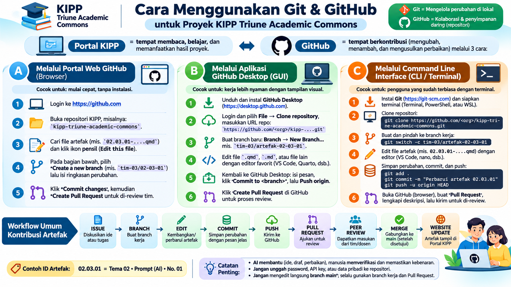
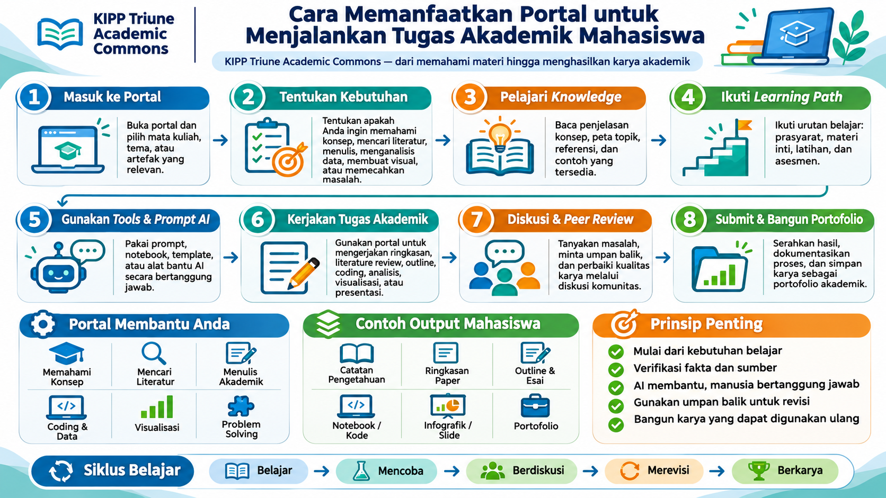

# Repositori, Portal, dan Workflow Kolaboratif

## Satu portal, satu repositori bersama

Proyek dirancang sebagai website/portal terintegrasi dengan enam tema, indeks 42 artefak, enam Learning Paths, Cases, panduan kontribusi, serta GitHub Issues dan Pull Requests. Repositori dapat diperluas menjadi portal untuk beberapa mata kuliah, tetapi tahap UAS berfokus pada pilot yang dapat diuji.

{#fig-repository-1 width="100%" fig-align="center"}


## Penomoran artefak

Kode konseptual **TT.JJ.NN**: dua digit tema, dua digit jenis, dua digit urutan. JJ = 01 Knowledge, 02 Skills, 03 Prompts, 04 Case Study. Contoh `02.03.01` adalah Prompt pertama Tema 02. Beberapa dokumen lama memakai ID asal seperti `P-R01`; hubungan ke ID baru perlu dipertahankan pada metadata/registri, bukan dihapus tanpa jejak.

## Struktur folder rekomendasi

```text
kipp-academic-commons/
  _quarto.yml
  topics/
    01-ai-learning/
      01-knowledge/
      02-skills/
      03-ai-prompts/
      04-case-studies/
    02-literature-research/
    03-academic-writing/
    04-coding-data/
    05-visualization-presentation/
    06-academic-problem-solving/
  agents/
  docs/
  templates/
  ARTIFACT_REGISTER.csv
  .github/workflows/
```

Penataan nyata repositori prototipe mungkin memakai folder `topics/learning/...`; lakukan migrasi terencana menggunakan registri, agar tautan tidak putus. Pada buku ini, daftar asli CSV disertakan untuk pelacakan.

## GitHub collaboration

{#fig-github-1 width="100%" fig-align="center"}


**Issue → Branch → Edit → Commit → Push → Pull Request → Peer Review → Revisi → Merge → Publish.** Issue menyatakan tujuan dan acceptance criteria; PR membuktikan perubahan serta pengujian; reviewer memeriksa isi, referensi, dan keterpakaian. Status bukan sekadar *done*, tetapi *verified* saat standar mutu terpenuhi.

## Panduan pengguna portal

{#fig-portal-2 width="100%" fig-align="center"}


Pengguna sebaiknya mulai dari pertanyaan atau kasus, bukan membaca seluruh artefak secara berurutan. Portal mengarahkan ke learning path, knowledge yang relevan, tutorial skills, prompt, lalu penilaian kemampuan mandiri. Untuk produk akademik yang berdampak, selalu tampilkan sumber, batasan dan cara verifikasi.

## Penerbitan Quarto

Sumber `.qmd` disimpan dalam GitHub, konfigurasi `_quarto.yml` memakai proyek `book` untuk buku ini dan dapat memakai proyek `website` untuk portal belajar. GitHub Actions dapat membangun versi HTML ketika PR telah ditelaah. Proyek buku dapat dijalankan dengan `quarto render --to html` dan hasilnya berada di folder `_book/`.

## Menetapkan satu sumber kebenaran untuk registri

Registri artefak sebaiknya menjadi tempat utama menyimpan ID, judul, tema, jenis, penanggung jawab, status, dan lokasi berkas. Halaman indeks dapat disusun dari informasi tersebut agar tidak ada daftar yang saling berbeda. Ketika file dipindah, perbarui path dan pertahankan hubungan dengan ID lama. ID menyatakan identitas artefak, sedangkan lokasi dapat berubah mengikuti organisasi proyek.

Status dapat dibedakan menjadi direncanakan, draf, direview, diuji, dan diterima. “Diuji” perlu mengacu pada bukti, misalnya laporan pengujian pengguna atau log eksekusi. Jangan mengubah status hanya karena berkas telah diunggah. Pada rilis, periksa bahwa seluruh artefak yang dinyatakan diterima memang tersedia pada versi yang sama.

## Memisahkan sumber dan hasil terbitan

Sumber `.qmd`, gambar asli, bibliografi, dan data yang boleh dibagikan merupakan input penerbitan. Folder `_book/` berisi hasil render. Mengedit HTML keluaran secara langsung membuat perbaikan hilang pada render berikutnya. Lakukan perubahan pada sumber, kemudian bangun ulang. Dokumentasi Quarto menjelaskan penggunaan proyek buku dan struktur bab [@quarto-book].

Simpan informasi lingkungan yang cukup untuk menjalankan contoh: bahasa, dependensi, versi penting, dan cara memperoleh data. Contoh yang hanya ilustratif diberi penanda tidak dieksekusi; contoh yang disebut telah diuji perlu benar-benar dijalankan pada input yang dicatat. Praktik ini membantu membedakan materi pengantar dari hasil komputasi yang dapat direproduksi [@wilson2017].

## Contoh alur review satu perubahan

Sebuah Issue menyatakan bahwa tutorial Bayes tidak menjelaskan format persentase. Kriteria penerimaannya: format input dinyatakan, contoh 1% menghasilkan posterior yang benar, dan pengguna baru dapat mengikutinya. Kontributor membuat branch, memperbaiki sumber, menjalankan render, dan mencatat pemeriksaan. Pull Request memuat masalah, perubahan perilaku, serta bukti yang relevan.

Reviewer mencoba langkah yang sebelumnya gagal, memeriksa angka, dan melihat halaman hasil. Jika ada kesalahan sumber dan kesalahan tampilan, keduanya dicatat terpisah agar perbaikannya tepat. Sesudah revisi diterima, perubahan digabung dan rilis diperbarui. Penjelasan ini merupakan pola kolaborasi yang disarankan; rincian fitur GitHub dapat berubah dan perlu merujuk dokumentasi resmi saat implementasi.

## Pemeriksaan otomatis dan batasnya

Pipeline dapat memeriksa bahwa proyek dapat dirender, tautan internal mengarah ke berkas yang ada, ID tidak ganda, dan bibliografi menyelesaikan kunci sitasi. Pemeriksaan isi tetap memerlukan manusia: sumber dapat ada tetapi tidak mendukung klaim; tutorial dapat dirender tetapi tidak dapat diikuti; gambar dapat muncul tetapi menyesatkan. Otomasi mengurangi kesalahan mekanis dan menyediakan waktu untuk review substantif.

Pisahkan proses membangun artefak dari proses memublikasikannya. Preview membantu reviewer menilai hasil sebelum perubahan menjadi versi publik. Simpan versi rilis agar halaman yang dipakai untuk penilaian dapat diketahui. Jika kesalahan penting ditemukan sesudah publikasi, sediakan catatan koreksi dan perbarui sumber terkait.

## Merawat portal setelah tenggat

Tentukan pemilik pemeliharaan, cara melaporkan kesalahan, dan masa tinjau sumber yang mudah berubah. Tutorial layanan daring lebih cepat kedaluwarsa daripada penjelasan dasar probabilitas. Penandaan tanggal pemeriksaan membantu pengguna menilai apakah langkah teknis masih sesuai. Materi yang belum diperiksa ulang dapat diberi status arsip tanpa menghapus sejarahnya.

Sebagai latihan, pilih satu artefak dan lakukan audit dari registri sampai halaman hasil. Periksa identitas, lokasi, sumber, tampilan, serta bukti penerimaan. Lalu simulasikan pemindahan file dan jelaskan apa yang perlu diperbarui. Tujuannya agar struktur repositori mendukung pengguna dan reviewer, bukan hanya terlihat teratur bagi penyusunnya.
