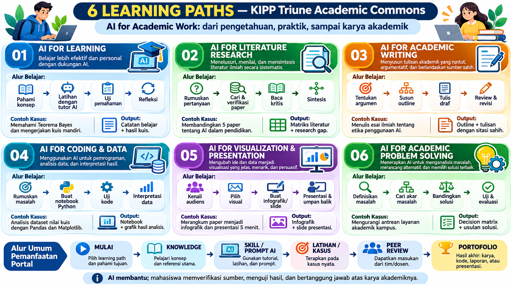

# Prakata {.unnumbered}

{#fig-overview-1 width="100%" fig-align="center"}

## Tentang buku ini

Buku ini mengembangkan sebuah gagasan yang tumbuh bertahap melalui diskusi proyek **KIPP (Komunikasi Interpersonal dan Publik)**: seseorang atau suatu sistem perlu berpindah dari keadaan awal **A** menuju keadaan tujuan **B**. Perpindahan itu memerlukan peta keadaan dan rute, tujuan antara, kemampuan menjalankan pekerjaan, sumber daya lingkungan, serta mekanisme untuk belajar dan mengubah strategi. Keseluruhan proses dikendalikan melalui **PUDAL — Perceive, Understand, Decide, Act, Learn**.

Gagasan berkembang dari learning paths enam tema akademik menjadi model **Hierarchical Adaptive Resource-Aware PUDAL Navigation and Learning Engine**. Di dalamnya terdapat lima fungsi yang masing-masing dapat menjalankan putaran PUDAL: *Orientation, Understanding, Planning, Execution,* dan *Learning*. Engine dapat bekerja secara **natural, instrumental,** dan **vehicular**, termasuk dalam kombinasi antartahap.

Buku ini juga menjelaskan penerapannya pada proyek UAS **Triune Academic Commons**: 12 kelompok mahasiswa, 6 learning paths/agen akademik, dan 42 artefak. Gambar yang dihasilkan pada percakapan awal disertakan sebagai bahan visual pembelajaran. Rumus matematika dan skema kendali adalah **formalisasi konseptual yang diusulkan**, bukan hasil validasi empiris atau model fisika tunggal untuk semua jenis sumber daya.

## Cara membaca

- **Bagian I**: tujuan komunikasi, TAIDA, Triune Intelligence, dan empat pendekatan pengembangan artefak.
- **Bagian II**: graf masalah, engine, sumber daya dan energi, lima PUDAL, milestones, pembelajaran, dan formulasi matematis.
- **Bagian III**: implementasi enam agen, enam learning paths, proyek UAS, repositori, evaluasi, dan agenda penelitian.
- **Bagian IV**: pendalaman enam tema TISE (Learning, Literature Study, Academic Writing, Computational & Data Literacy, Visualization, Problem Solving) sebagai modul, kasus, langkah kerja, rubrik, dan template asesmen.
- **Lampiran**: daftar artefak, templat kasus, istilah, asal bahan dan indeks gambar, serta panduan perangkat dan pembangunan Quarto.

> **Tesis utama:** PUDAL mengendalikan pilihan dan operasi engine yang memanfaatkan sumber daya lingkungan untuk melakukan kerja sehingga sistem dapat menempuh transisi dari A melalui milestones menuju B; pembelajaran dan eksplorasi memperluas serta memperbaiki peta dan kemampuan untuk mencapai tujuan.

**Status:** naskah sintesis dan rancangan pedagogis, disusun dari rangkaian diskusi hingga 22 November 2026. Penetapan bobot UAS serta penggunaan resmi di kelas memerlukan persetujuan pengampu mata kuliah.

## Hubungan buku induk dan enam tema

Buku ini menggabungkan **rancangan navigasi PUDAL dan Triune Academic Commons** dengan
**buku Enam Tema Kompetensi Akademik Berbasis TISE** sebagai Bagian IV.
Keberhasilan dibedakan menjadi **hasil kerja** dan **hasil belajar**, sehingga
AI tidak hanya menyelesaikan tugas, tetapi membantu manusia menjadi lebih mampu.
Mulailah dari [peta enam learning paths](13-enam-learning-paths.qmd), kemudian lanjutkan
ke [pengantar Bagian IV](tise-six-themes/00-pengantar-enam-tema.qmd).
