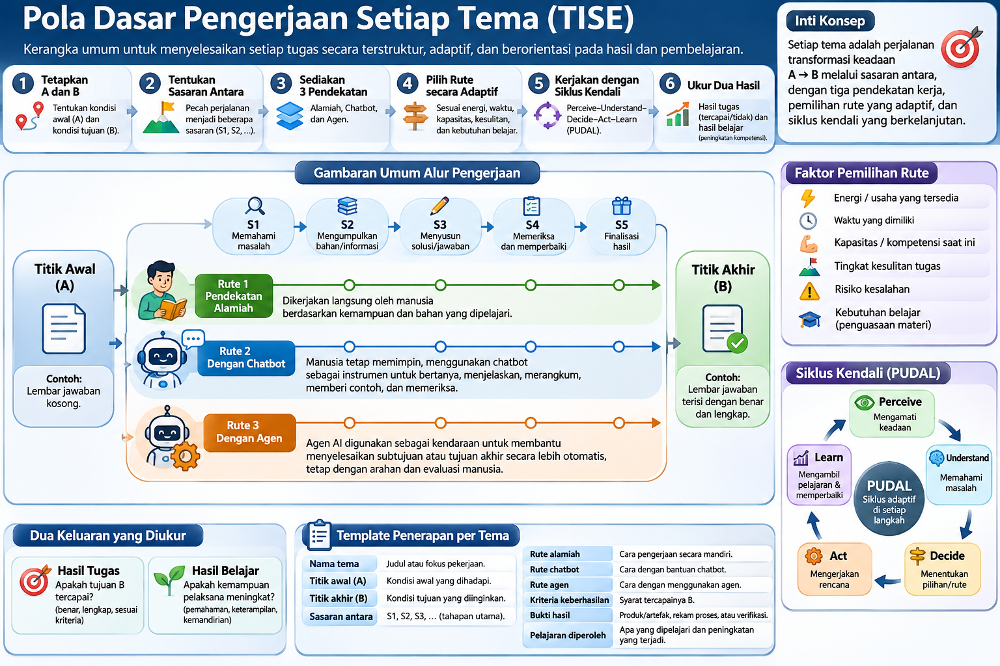

# Pengantar Enam Tema Kompetensi Akademik Berbasis TISE

::: {.callout-note title="Posisi dalam buku gabungan"}
Bab ini membuka **Bagian IV** dari buku *PUDAL: Navigasi Cerdas, Engine, dan Pembelajaran Adaptif*.
Bagian I–II menjelaskan kerangka TAIDA, Triune Intelligence, PUDAL, graf keadaan, rute, sumber daya, dan mesin kerja.
Bagian III merancang *Triune Academic Commons* dan enam jalur pembelajaran.
Bagian IV ini memperluas keenam jalur tersebut menjadi **modul operasional**: kasus, kontrak A→B, sasaran antara,
pilihan kerja mandiri/chatbot/agen, bukti hasil tugas, bukti hasil belajar, dan rubrik.
Lihat [Enam Learning Paths Berbasis PUDAL](../13-enam-learning-paths.qmd) sebagai peta penghubung.
:::

::: {.callout-note title="Status naskah"}
Buku ini adalah **edisi pengembangan awal**, disusun dari rangkaian diskusi tentang enam tema proyek akademik TISE. Angka-angka simulasi merupakan contoh pembelajaran, bukan bukti penelitian lapangan. Infografik adalah ilustrasi pendukung; rumus dan angka sebaiknya dirujuk pada tabel serta teks yang telah diperiksa.
:::

{#fig-cover fig-cap="Pola dasar pengerjaan setiap tema: kondisi awal, sasaran antara, tiga pendekatan kerja, dan dua hasil yang dievaluasi." width="100%"}

## Orientasi buku

Buku ini menempatkan penggunaan Artificial Intelligence (AI) sebagai bagian dari rekayasa pembelajaran dan pekerjaan akademik. Titik awalnya bukan teknologi yang akan dipakai, melainkan **perubahan keadaan** yang ingin dicapai oleh peserta. Setiap tugas diberi kondisi awal $A$, kondisi tujuan $B$, sasaran antara, alternatif rute, sumber daya, instrumen, metrik, dan bukti keberhasilan.

Pembelajaran dirancang melalui tiga pendekatan yang dapat ditempuh secara berurutan maupun dipilih secara adaptif:

1. **Alamiah/mandiri:** peserta membaca, mencoba, berpikir, menggambar, menghitung, dan menguji dengan kemampuannya sendiri.
2. **Chatbot sebagai instrumen:** peserta tetap memimpin, sementara dialog AI memperkuat pemahaman, memberikan petunjuk, mengkritik, dan membantu perbaikan.
3. **Agen AI sebagai kendaraan:** peserta mendelegasikan subpekerjaan yang terdefinisi, memanfaatkan orkestrasi alat, lalu memvalidasi hasil dan mempertanggungjawabkannya.

Dua keluaran dicatat secara terpisah: **hasil pekerjaan** dan **hasil belajar**. Sistem dapat membantu mengerjakan tugas tanpa otomatis meningkatkan kompetensi. Oleh karena itu pembelajaran mandiri, retensi, dan transfer perlu diuji tanpa bantuan AI.

## Enam tema yang saling berhubungan

| Tema | Nama yang disepakati | Kasus utama | Produk |
|---|---|---|---|
| 1 | **Learning** | Probabilitas bersyarat, Bayes, penyakit langka | Jawaban, penjelasan konsep, asesmen mandiri |
| 2 | Literature Study | Penggunaan AI yang tepat dalam dunia akademik | Laporan State of the Art lima lapisan |
| 3 | Academic Writing | AI yang etis dalam dunia akademik dan ruang publik | Esai ilmiah argumentatif |
| 4 | Computational & Data Literacy | Penggunaan AI dan kemampuan kognitif mahasiswa | Dataset terolah, notebook, analisis/simulasi |
| 5 | Visualization / Visual Knowledge Engineering | Visualisasi AI akademik dan paper-to-visual | Diagram, infografik, slide |
| 6 | Problem Solving | Aspirasi mahasiswa, standar pendidikan, tuntutan industri | Solusi multipihak dan evaluasi |

**Catatan terminologi:** Tema 1 dengan sengaja bernama *Learning*, bukan *Problem Solving*. Penyelesaian soal Bayes merupakan **kasus untuk mengukur belajar**. *Problem Solving* yang menyatukan berbagai kompetensi menjadi Tema 6.

## Cara membaca dan menggunakan

Bab 1 membahas kerangka bersama. Bab 2–7 dapat dipakai sebagai modul praktikum, masing-masing dengan kontrak tugas, proses, kasus, instrumen, dan rubrik. Bab 8 menjelaskan program implementasi serta evaluasi, sedangkan Bab 9 berisi template yang dapat disalin. Lampiran mencatat perangkat lunak dan cara membangun buku.

Tujuan buku bukan menggantikan nalar mahasiswa dengan jawaban AI, melainkan membuat penggunaan AI **terencana, dapat diperiksa, beretika, dan meningkatkan kecakapan manusia**.
