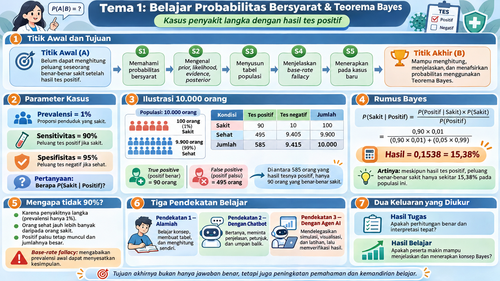

# Tema 1 — Learning: Probabilitas Bersyarat dan Bayes

{#fig-t1 fig-cap="Infografik Tema 1: kasus penyakit langka, pemahaman probabilitas bersyarat, dan tiga pendekatan belajar." width="100%"}

## Kontrak pembelajaran

**Titik A:** belum dapat membedakan $P(D\mid +)$ dari $P(+\mid D)$ atau menafsirkan hasil tes penyakit langka. **Titik B:** mampu menghitung posterior, menjelaskan penyebabnya, menguji kewajaran jawaban, serta menerapkan pada soal baru tanpa bantuan.

Sasaran antara: (S1) probabilitas bersyarat; (S2) prior, likelihood, evidence, posterior; (S3) tabel populasi; (S4) *base-rate fallacy*; (S5) transfer. Contoh ini menggunakan **parameter hipotetis untuk belajar**, bukan estimasi klinis.

## Kasus inti: hasil tes positif penyakit langka

Misalkan prevalensi penyakit $P(D)=0{,}01$, sensitivitas $P(+\mid D)=0{,}90$, dan spesifisitas $P(-\mid \neg D)=0{,}95$. Maka peluang positif palsu $P(+\mid\neg D)=0{,}05$.

| Kelompok dari 10.000 orang | Tes positif | Tes negatif | Total |
|---|---:|---:|---:|
| Sakit | 90 | 10 | 100 |
| Sehat | 495 | 9.405 | 9.900 |
| **Total** | **585** | **9.415** | **10.000** |

Dengan Teorema Bayes:

$$
P(D\mid +)=\frac{P(+\mid D)P(D)}{P(+\mid D)P(D)+P(+\mid\neg D)P(\neg D)}
=\frac{0.90\cdot0.01}{0.90\cdot0.01+0.05\cdot0.99}
\approx 0.1538.
$$

Hasilnya **15,38%**: dari 585 orang yang positif, sekitar 90 benar-benar sakit. Sensitivitas 90% tidak sama dengan probabilitas sakit setelah positif. Prevalensi rendah menyebabkan kelompok sehat yang besar menghasilkan lebih banyak positif palsu, inilah konteks kekeliruan *base-rate fallacy*.

## Tiga pendekatan belajar

**Alamiah:** peserta menggambar tabel $2\times2$, menurunkan rumus, menghitung dengan kertas dan kalkulator, lalu menjelaskan dengan kata-kata sendiri.

**Chatbot sebagai instrumen:** peserta meminta tutor Socratic memberikan satu pertanyaan sekaligus, petunjuk bertahap, dan evaluasi alasan **tanpa langsung membocorkan jawaban**.

**Agen sebagai kendaraan:** peserta memberi agen mandat terbatas untuk membangun simulator variasi prevalensi/sensitivitas/spesifisitas, menyusun grafik dan latihan, sementara peserta wajib menafsirkan serta memvalidasi.

::: {.callout-tip title="Contoh prompt tutor"}
Ajarkan probabilitas bersyarat dan Teorema Bayes melalui kasus penyakit langka. Tanyakan satu hal pada satu waktu; minta saya membuat tabel dari 10.000 orang; berikan petunjuk saat saya buntu; uji pemahaman dengan kasus baru tanpa langsung memberikan jawaban.
:::

## Variasi dan eksperimen kecil

Tahan sensitivitas dan spesifisitas tetap, ubah prevalensi dari 0,1% ke 1%, 5%, dan 10%. Amati perubahan posterior dan jelaskan mengapa. Ketika metrik input berubah, periksa kembali apakah kasus masih mempunyai definisi populasi yang sama.

```{python}
#| eval: false
#| echo: true
def posterior(prevalensi, sensitivitas=.90, spesifisitas=.95):
    fpr = 1 - spesifisitas
    return sensitivitas * prevalensi / (
        sensitivitas * prevalensi + fpr * (1 - prevalensi)
    )

for p in [.001, .01, .05, .10]:
    print(f"Prevalensi {100*p:.1f}% -> posterior {100*posterior(p):.2f}%")
```

## Rubrik hasil tugas dan belajar

| Aspek | Bukti |
|---|---|
| Akurasi | Tabel dan hasil probabilitas benar |
| Pemahaman | Mampu membedakan $P(D\mid +)$ dan $P(+\mid D)$ |
| Penalaran | Mampu menerangkan pengaruh prevalensi |
| Transfer | Menyelesaikan kasus baru tanpa AI |
| Kemandirian | Mampu mendeteksi kesalahan chatbot/agen |

**Produk:** lembar jawaban, perhitungan, tabel dan/atau simulator, jurnal bantuan AI, serta tes transfer mandiri. Nilai kognitif tidak disamakan dengan kecepatan menghasilkan angka.

## Mengapa penyebut berubah ketika kita menerima informasi baru?

Probabilitas bersyarat dapat dimulai dari gagasan menyaring ruang kemungkinan. Dalam populasi 10.000 orang, pertanyaan “berapa peluang seseorang sakit?” memakai seluruh populasi sebagai penyebut. Setelah diketahui hasil tesnya positif, pertanyaannya berubah: dari kelompok yang positif, berapa yang sakit? Informasi positif memperkecil kelompok pembanding menjadi 585 orang. Karena itu penyebutnya bukan lagi 10.000 dan bukan pula 100 orang sakit. Buku statistik OpenStax menjelaskan penggunaan tabel kontingensi untuk membaca probabilitas bersyarat [@openstax-stat]; kasus dan parameter di bab ini merupakan ilustrasi tersendiri.

Penurunan rumus membantu menghubungkan tabel dengan simbol. Berdasarkan definisi, $P(D\mid+)=P(D\cap+)/P(+)$. Irisan $P(D\cap+)$ dapat ditulis sebagai $P(+\mid D)P(D)$. Sementara itu, kejadian positif terbagi menjadi dua bagian yang saling lepas: positif pada orang sakit dan positif pada orang sehat. Menjumlahkan keduanya menghasilkan penyebut pada rumus Bayes. Setiap suku dengan demikian mempunyai arti populasi, bukan sekadar posisi dalam persamaan.

## Membandingkan beberapa prior dengan perhitungan lengkap

Dengan sensitivitas 0,90 dan spesifisitas 0,95 yang sama, perubahan prevalensi menghasilkan nilai berikut. Angka ini hasil perhitungan parameter hipotetis, bukan data kesehatan.

| Prevalensi | Positif benar per 10.000 | Positif palsu per 10.000 | Peluang sakit jika positif |
|---|---:|---:|---:|
| 0,1% | 9 | 499,5 | 1,77% |
| 1% | 90 | 495 | 15,38% |
| 5% | 450 | 475 | 48,65% |
| 10% | 900 | 450 | 66,67% |

Nilai pecahan orang pada baris pertama menyatakan frekuensi harapan, bukan jumlah aktual dalam satu sampel. Jika ingin seluruh entri bilangan bulat, gunakan populasi pembanding 100.000. Tabel menunjukkan bahwa kualitas sebuah tes dan komposisi populasi sama-sama memengaruhi penafsiran hasil. Perbandingan ini menahan parameter tes tetap; pada penerapan nyata asumsi tersebut perlu diperiksa.

Representasi lain memakai odds. Prior odds pada prevalensi 1% adalah $0{,}01/0{,}99=1/99$. Likelihood ratio positif adalah $0{,}90/0{,}05=18$. Posterior odds menjadi $18/99$, lalu dikonversi menjadi probabilitas $18/(18+99)=15{,}38\%$. Cara ini bermanfaat untuk melihat bagaimana bukti mengubah keyakinan relatif, tetapi mahasiswa tetap perlu memahami asal pembilang dan penyebut.

## Merancang dialog tutor yang benar-benar mendiagnosis

Tutor sebaiknya memulai dari pertanyaan “kelompok mana yang menjadi penyebut?” Jika peserta menjawab “orang sakit”, tutor dapat meminta peserta membaca ulang bagian setelah tanda kondisi. Kesalahan itu menunjukkan pertukaran $P(D\mid+)$ dan $P(+\mid D)$, sehingga memberikan rumus tambahan belum tentu memperbaiki pemahaman. Jika penyebut sudah benar tetapi hitungan salah, bantuan dapat beralih ke aritmetika.

Sesudah contoh selesai, peserta menutup penjelasan lalu merekonstruksi tabel. Studi Roediger dan Karpicke menunjukkan bahwa pada tugas mempelajari teks yang mereka uji, praktik mengingat kembali memberi keuntungan retensi pada tes tertunda dibandingkan membaca ulang [@roediger2006]. Rancangan latihan Bayes di sini memakai prinsip mencoba mengambil kembali pengetahuan; studi tersebut tidak secara langsung menguji tutor AI atau membuktikan efektivitas seluruh modul ini.

## Soal transfer beserta pembahasan

Sebuah filter pesan menerima 2% spam. Ia menandai 95% spam, tetapi juga menandai 4% pesan bukan spam. Dari 10.000 pesan terdapat 200 spam; 190 ditandai. Dari 9.800 bukan spam, 392 ditandai. Jadi hanya $190/(190+392)=32{,}65\%$ pesan bertanda yang merupakan spam. Jawaban 95% keliru karena menjawab peluang ditandai jika spam, bukan peluang spam jika ditandai.

Untuk latihan berikutnya, ubah proporsi spam menjadi 20% sambil mempertahankan parameter filter. Hasilnya $1.900/(1.900+320)=85{,}59\%$. Peserta perlu menjelaskan perubahan ini melalui banyaknya pesan dari kedua kelompok, bukan hanya mengutip rumus. Dua hasil tersebut memperlihatkan transfer struktur penalaran dari tes hipotetis ke penyaringan pesan.

## Kesalahan lanjutan dan batas model

Dua hasil positif berturut-turut tidak otomatis berarti likelihood ratio boleh dikuadratkan. Perkalian tersebut memerlukan asumsi tentang ketergantungan kedua pengukuran setelah kondisi sebenarnya diketahui. Menguji ulang objek dengan alat dan prosedur identik dapat menghasilkan kesalahan yang berkaitan. Dalam latihan, nyatakan asumsi independensi bersyarat sebelum menghitung. Pada akhir modul, peserta dianggap memahami model jika mampu menyebutkan informasi yang belum tersedia, selain menghitung jawaban yang tersedia.
