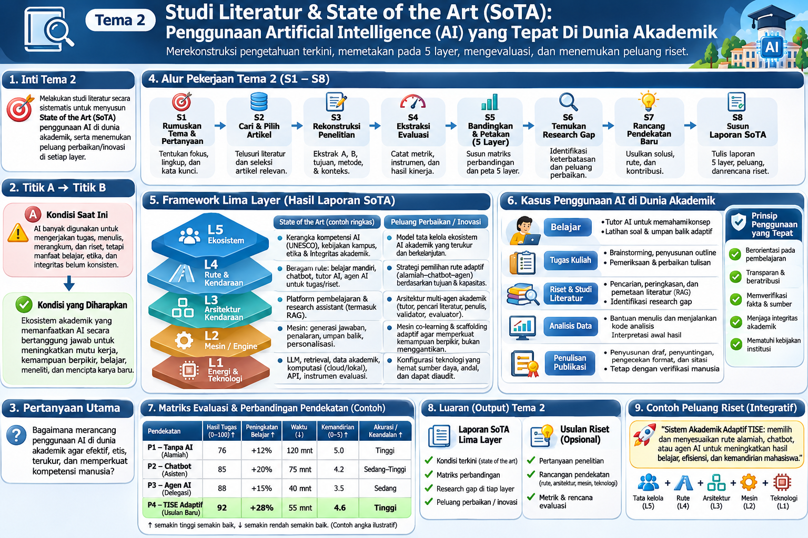

# Tema 2 — Literature Study dan State of the Art Lima Lapisan

{#fig-t2 fig-cap="Infografik Tema 2: alur studi literatur, pemetaan lima lapisan, perbandingan pendekatan, dan peluang riset." width="100%"}

## Kontrak tugas

**A:** peneliti mempunyai topik tetapi belum mengetahui peta pengetahuan terkini, solusi sebelumnya, bukti, dan celah yang penting. **B:** laporan *State of the Art* (SoTA) yang berisi **lima bagian utama—L5 hingga L1—masing-masing dengan peluang perbaikan dan metrik untuk membuktikan pendekatan baru**. Sintesis lintas lapisan menghubungkan kelimanya dan dapat menurunkan satu atau lebih proposal.

## Delapan sasaran antara

S1 merumuskan tema; S2 memilih artikel; S3 merekonstruksi perjalanan riset A→B; S4 mengekstraksi instrumen serta metrik pengukuran; S5 memetakan dan membandingkan pada lima lapisan; S6 mengidentifikasi gap; S7 mengusulkan rute/arsitektur/mesin/teknologi baru; S8 menyusun kontrak evaluasi serta laporan SoTA.

## Research Journey Card

Setiap artikel menjadi sebuah kartu yang dapat dilacak ke halaman/section sumber.

| Field | Pertanyaan ekstraksi |
|---|---|
| Identitas & bukti | Judul, DOI, tahun, bagian/halaman, jenis studi |
| A | Keadaan atau masalah awal penulis |
| B | Kinerja/keadaan tujuan yang dinyatakan |
| Sasaran antara | Tahapan, fungsi, asumsi, batasan |
| Rute | Metodologi dan strategi |
| Kendaraan | Sistem/artefak yang dibangun |
| Mesin | Mekanisme atau algoritma pemrosesan |
| Teknologi & sumber daya | Dataset, instrumen, komputasi, waktu, keahlian |
| Metrik/protokol | Apa diukur, dengan apa dan bagaimana |
| Hasil | Bukti dan keterbatasannya |
| Peluang | Kelemahan/gap, dibedakan dari spekulasi pembaca |

Klaim **penulis artikel** dan **interpretasi penelaah** sebaiknya disimpan pada kolom terpisah.

## Lima bagian wajib laporan SoTA

### L5 — Ekosistem

Uraikan siapa stakeholder, tata kelola, tujuan, kebutuhan, nilai, dan keberlanjutan. Untuk AI akademik, unsur utamanya meliputi mahasiswa, pendidik, peneliti, institusi, penerbit, masyarakat dan regulator. **Peluang:** tata kelola yang mempertahankan integritas, otonomi, akses, dan pertumbuhan kemampuan.

### L4 — Rute dan kendaraan

Rekonstruksi strategi menyelesaikan aktivitas: belajar mandiri, chatbot tutor, agen AI, penelusuran sumber, pelatihan, dan evaluasi. **Peluang:** memilih rute adaptif menurut kapasitas, energi, waktu, risiko, dan capaian belajar.

### L3 — Arsitektur kendaraan

Bandingkan desain platform, workflow, retrieval, izin, penyimpanan konteks, pemeriksa dan evaluator. **Peluang:** platform multi-agen dengan pelacakan sumber, rubrik, penilaian tanpa AI, dan tata kelola pengguna.

### L2 — Mesin

Bandingkan mekanisme retrieval, reasoning, feedback, teaching-back, active recall, scaffolding, fading assistance, dan pengendalian kesalahan. **Peluang:** *adaptive co-learning engine* yang mengatur bantuan dan menuntut bukti peningkatan kompetensi.

### L1 — Energi dan teknologi

Bandingkan LLM, penyimpanan dataset, API, model lokal, komputasi, energi fisik, biaya dan keahlian. **Peluang:** konfigurasi lebih hemat, privat, dapat diaudit, serta mudah direproduksi.

## Research Comparison Matrix dan kontrak evaluasi

| Layer | Yang dibandingkan | Contoh metrik (harus disesuaikan kasus) |
|---|---|---|
| L5 | Kebijakan dan nilai antar-stakeholder | Kompetensi, akses, keadilan, integritas |
| L4 | Rute dan kinerja tugas | Mutu keluaran, waktu, retensi, transfer |
| L3 | Arsitektur platform | Kegagalan, auditabilitas, interoperabilitas |
| L2 | Mesin pembelajaran/AI | Umpan balik benar, ketergantungan, learning gain |
| L1 | Teknologi dan sumber daya | Latensi, biaya, konsumsi energi, privasi |

Metrik merupakan **apa** yang diukur, instrumen merupakan **dengan apa**, dan protokol merupakan **bagaimana**. Perbandingan metode hanya valid bila data, ukuran, kondisi dan baseline cukup sebanding atau perbedaannya dijelaskan.

## Kasus: penggunaan AI yang tepat di dunia akademik

**Pertanyaan penelitian:** dapatkah sistem yang mengadaptasi tiga rute (mandiri, chatbot, agen) menghasilkan kualitas tugas yang tinggi **sekaligus** meningkatkan kompetensi mandiri dibandingkan pemberian bantuan AI tetap?

Kandidat inovasi meliputi L5 tata kelola akademik, L4 route selection, L3 platform akademik multi-agen, L2 mesin scaffolding, dan L1 stack AI yang efisien. Semua adalah **hipotesis peluang**, bukan klaim gap yang sudah dibuktikan; kebaruan memerlukan penelusuran literatur dan validasi tambahan.

Untuk praktik SoTA, mulai dari lima artikel inti, lalu perluas ke studi yang mewakili metode dan kontroversi. Untuk SLR formal, gunakan protokol pencarian serta inklusi–eksklusi yang transparan dan standar pelaporan yang relevan (misalnya PRISMA 2020). Jangan menganggap ukuran korpus tertentu sebagai syarat universal.

## Tiga pendekatan

- **Alamiah:** pencarian, pembacaan kritis, pengisian kartu, sintesis, dan perumusan gap mandiri.
- **Chatbot:** membantu membaca bagian sukar, menguji interpretasi, menyusun perbandingan, mengkritisi hipotesis dengan referensi yang diperiksa.
- **Agen:** menjalankan pencarian dan penyaringan sumber yang diizinkan, mengisi kartu dengan provenance, membangun matriks dan draf laporan—peneliti tetap mengaudit klaim.

## Produk akhir

Laporan lima bab analitis L5–L1, daftar artikel terpilih, seluruh Research Journey Cards, Research Comparison Matrix, daftar gap beserta derajat kepastian, dan Research Evaluation Contract untuk pendekatan baru.

**Rujukan pendukung:** kerangka kompetensi AI UNESCO dan *Ethics of AI Recommendation*, tinjauan riset pendidikan, serta sumber asli studi yang dipilih; lihat [Referensi](references.qmd).

## Dari topik luas ke pertanyaan yang dapat ditelusuri

“AI dalam pendidikan” terlalu luas untuk menjadi satu tugas penelaahan. Mulailah dengan populasi, bentuk bantuan, pembanding, dan hasil. Contoh pertanyaan yang lebih terarah adalah: pada mahasiswa pengantar statistika, bagaimana tutor berbasis dialog dibandingkan pemberian jawaban langsung dalam mendukung transfer tanpa bantuan? Rumusan ini menentukan istilah pencarian dan data yang perlu diekstraksi. Ia juga mencegah artikel tentang kepuasan pengguna diperlakukan sebagai jawaban langsung tentang transfer.

Susun kelompok istilah untuk konsep yang sama, misalnya `generative AI OR large language model`, `tutoring OR scaffolding`, dan `transfer OR retention`. Hubungkan kelompok dengan AND, kemudian sesuaikan sintaks terhadap basis data yang digunakan. Catat tanggal, basis data, string persis, dan pembatasan bahasa atau tahun. Hasil pencarian yang sedikit dapat berarti topiknya sempit, istilahnya tidak cocok, atau indeksnya terbatas; ketiga kemungkinan perlu dibedakan sebelum menyatakan tidak ada penelitian.

## Menyeleksi tanpa mengubah aturan mengikuti hasil

Untuk praktikum, tentukan lebih dahulu bahwa studi harus mendeskripsikan peserta, intervensi, dan hasil belajar yang relevan. Artikel opini masih dapat dipakai untuk konteks kebijakan, tetapi tidak dikelompokkan sebagai eksperimen efektivitas. Seleksi dilakukan dari judul dan abstrak menuju teks penuh, dengan alasan eksklusi yang dapat ditinjau. Dua pembaca dapat menguji beberapa artikel bersama untuk menyamakan pengertian kriteria sebelum membagi pekerjaan.

PRISMA 2020 menyediakan pedoman pelaporan review sistematis beserta daftar periksa dan diagram alir [@prisma2020]. Memakai diagram tersebut tidak dengan sendirinya menjadikan pencarian lengkap atau studi berkualitas. Untuk SoTA kelas, jelaskan bahwa pencarian bersifat terarah dan terbatas apabila memang demikian. Transparansi cakupan lebih bernilai daripada memakai label SLR tanpa protokol yang memadai.

## Menilai bukti sebelum menyusun matriks lima lapisan

Satu artikel dapat mempunyai arsitektur sistem yang menarik tetapi evaluasi pendidikan yang lemah. Karena itu, nilai kontribusi konseptual, kecukupan metode, dan kekuatan klaim secara terpisah. Periksa siapa pesertanya, bagaimana pembanding dibentuk, kapan hasil diukur, apakah bantuan tetap tersedia saat tes, dan apakah peserta keluar dari studi. Sampel kecil tidak otomatis tidak berguna, tetapi estimasi dan generalisasinya perlu dibatasi.

Pertimbangkan dua studi hipotetis. Studi A membandingkan nilai latihan ketika peserta masih memakai chatbot. Studi B mengukur soal baru seminggu setelah chatbot dihentikan. Keduanya dapat relevan untuk L4 rute belajar, tetapi hasilnya menjawab pertanyaan berbeda. Matriks yang menggabungkan kedua skor menjadi satu peringkat “AI terbaik” menghilangkan perbedaan penting. Tulis jenis hasil pada kolom tersendiri sebelum membandingkan besar peningkatannya.

## Contoh sintesis lintas lapisan

Misalkan beberapa studi terpilih menunjukkan keluaran tugas yang baik, tetapi hanya sebagian melaporkan tes mandiri. Pada L5, persoalannya adalah nilai pendidikan yang ingin dijaga. Pada L4, pertanyaannya kapan bantuan dihentikan. Pada L3, sistem perlu mampu mencatat jenis bantuan. Pada L2, mekanismenya dapat berupa petunjuk bertahap. Pada L1, platform harus memungkinkan pencatatan tersebut dengan biaya dan perlindungan data yang sesuai. Hubungan lintas lapisan menghasilkan kebutuhan desain yang dapat ditelusuri dari masalah pendidikan sampai implementasi.

Sintesis yang hati-hati berbunyi: “Dalam korpus yang ditelaah, evaluasi transfer tanpa bantuan belum dilaporkan secara konsisten.” Pernyataan “belum ada penelitian tentang transfer” jauh lebih luas dan membutuhkan pencarian tambahan. Kandidat kebaruan kemudian dirumuskan sebagai desain yang akan diuji, disertai kemungkinan bahwa pendekatan serupa telah dikembangkan dengan istilah berbeda.

## Praktikum membaca satu sumber bersama

Gunakan artikel Roediger dan Karpicke [@roediger2006] untuk berlatih membedakan pertanyaan, kondisi pembanding, dan waktu pengukuran. Kartu perjalanan harus menyatakan bahwa studi tersebut meneliti pengambilan kembali dari ingatan pada bahan teks, bukan AI generatif. Ketika peserta mengusulkan tutor yang memakai retrieval practice, tandai hubungan itu sebagai penerapan konseptual yang masih perlu diuji. Latihan ini menguji apakah penelaah mampu memakai sumber tanpa memperluas klaimnya.

Produk akhir perlu mempunyai satu paragraf sintesis untuk setiap pertanyaan penting, bukan satu paragraf ringkasan untuk setiap artikel. Setiap paragraf menyebut pola persamaan, perbedaan yang menjelaskannya, dan implikasi yang masih terbuka. Reviewer kemudian memilih dua klaim utama dan menelusurinya sampai lokasi sumber. Jika jalur tersebut putus, perbaiki pencatatan sebelum menambah jumlah artikel.
