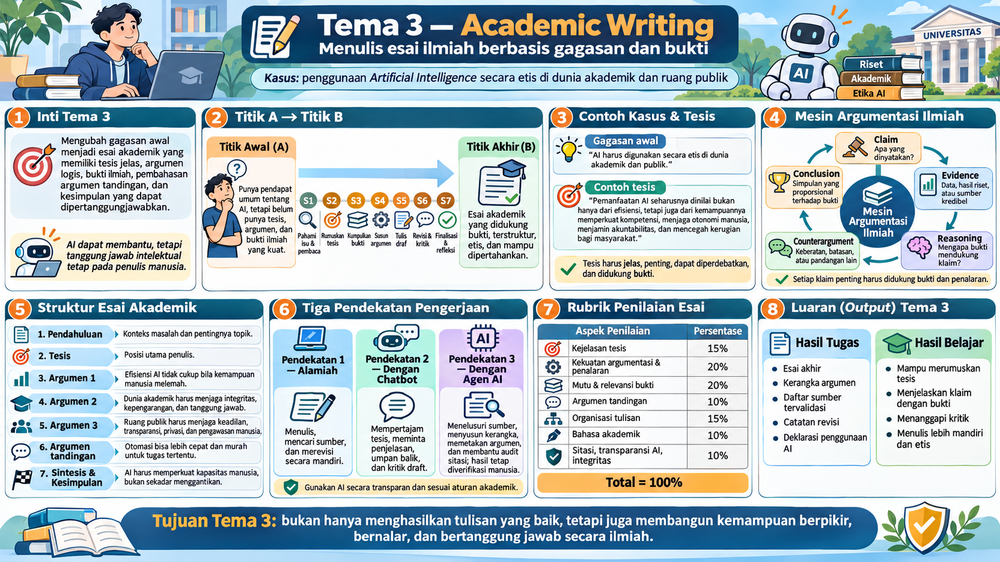

# Tema 3 — Academic Writing: Esai Berbasis Gagasan dan Bukti

{#fig-t3 fig-cap="Infografik Tema 3: perjalanan dari gagasan menjadi esai ilmiah, mesin argumentasi, tiga moda pengerjaan, dan rubrik." width="100%"}

## Kontrak tugas

**A:** penulis memiliki pendapat awal tanpa tesis tajam, argumen terstruktur, dan bukti ilmiah yang memadai. **B:** esai argumentatif yang mempunyai tesis jelas, bukti terverifikasi, penalaran, argumen tandingan, sintesis, sitasi, dan pengungkapan penggunaan AI sesuai aturan.

**Kasus:** *penggunaan AI secara etis di dunia akademik dan ruang publik*.

Contoh gagasan awal: “AI harus digunakan secara etis.” Contoh tesis yang dapat diperdebatkan: “Pemanfaatan AI tidak cukup dievaluasi melalui efisiensi; ia perlu dinilai pula melalui penguatan kompetensi, otonomi manusia, akuntabilitas, dan pencegahan kerugian sosial.”

## Sasaran antara S1–S7

1. Kenali isu, pembaca, tujuan esai dan batas argumen.
2. Rumuskan tesis yang jelas, penting, dapat diperdebatkan dan mungkin didukung bukti.
3. Kumpulkan literatur, data, kebijakan, bukti dan argumen tandingan.
4. Buat *argument map*: klaim, alasan, bukti, asumsi penghubung (*warrant*), batasan, dan rebuttal.
5. Susun kerangka, *topic sentences*, dan draf paragraf yang koheren.
6. Periksa logika, sitasi, akurasi, keaslian, serta relevansi bukti; revisi.
7. Finalisasi, deklarasikan bantuan AI, pertahankan argumen secara mandiri.

## Mesin argumentasi

{height="150mm"}

Klaim penting harus ditopang oleh sumber yang relevan; penulis harus **menjelaskan hubungan** antara sumber dan klaim. Sitasi palsu, angka yang tidak dapat ditemukan dan pernyataan lebih kuat daripada bukti merupakan kegagalan mutu.

## Contoh struktur esai

**Judul:** *AI yang Bertanggung Jawab: dari Produktivitas ke Penguatan Kapabilitas Manusia di Dunia Akademik dan Ruang Publik*.

| Bagian | Klaim atau topic sentence | Bukti yang perlu dicari |
|---|---|---|
| Pendahuluan | AI mengubah pembelajaran, penelitian dan layanan publik | Kajian dampak dan pedoman |
| Argumen 1 | Efisiensi bukan satu-satunya hasil yang bernilai | Studi kognitif, kerja dan pembelajaran |
| Argumen 2 | Integritas akademik menuntut tanggung jawab penulis | Kebijakan ilmiah, etika sitasi |
| Argumen 3 | Ruang publik menuntut tata kelola, fairness dan privasi | Etika AI dan tata kelola risiko |
| Argumen 4 | Bantuan AI perlu disesuaikan dengan tujuan dan kompetensi | Scaffolding, human–AI collaboration |
| Tandingan | Otomasi penuh mungkin lebih hemat untuk beberapa tugas | Bukti produktivitas dan risiko |
| Sintesis | AI perlu membantu manusia menjadi lebih mampu | Argumen terintegrasi |

**Contoh paragraf argumen yang dirancang:** Pemakaian AI untuk menyelesaikan aktivitas akademik sebaiknya bergantung pada fungsi aktivitas tersebut. Jika tujuan utamanya latihan penalaran, jawaban instan dapat mengurangi kesempatan berlatih; jika tugas bersifat administratif, otomasi dapat membebaskan waktu untuk aktivitas kognitif lebih penting. Karena itu aturan perlu membedakan tujuan belajar, tingkat kompetensi dan risiko pekerjaan. Paragraf akhir wajib diberi rujukan empiris yang sepadan sebelum dianggap siap publikasi.

## Tiga pendekatan dan instrumen

| Moda | Pekerjaan peserta | Fungsi AI |
|---|---|---|
| Alamiah | Rumuskan tesis, baca, tulis, revisi | Tidak diperlukan |
| Chatbot | Diskusikan tesis, uji klaim, minta kritik | Tutor dan editor, bukan pemilik argumen |
| Agen | Minta penelusuran sumber, audit konsistensi, formatting | Delegasi terbatas; semua klaim diverifikasi |

## Rubrik contoh

| Kriteria | Bobot |
|---|---:|
| Tesis | 15% |
| Argumentasi dan penalaran | 20% |
| Mutu dan verifikasi bukti | 20% |
| Argumen tandingan | 10% |
| Struktur dan koherensi | 15% |
| Bahasa akademik | 10% |
| Sitasi, transparansi AI dan integritas | 10% |

Selain skor esai, peserta menghadapi tanya jawab tanpa AI, menilai kritik, serta menulis paragraf baru. Kesalahan integritas serius ditangani dengan kebijakan tersendiri, bukan hanya pengurangan nilai biasa.

## Produk

Esai akhir, matriks klaim–bukti–sumber, peta argumen, histori revisi, deklarasi bantuan AI, serta rekaman asesmen pemahaman penulis.

## Mengembangkan tesis melalui pertanyaan yang dapat diperdebatkan

Esai akademik berkembang ketika penulis menemukan persoalan yang mempunyai lebih dari satu jawaban masuk akal. Pernyataan “AI memiliki manfaat dan risiko” hanya membuka topik. Pertanyaan “kapan bantuan AI dapat dibenarkan dalam tugas yang bertujuan melatih penalaran?” menghasilkan kebutuhan untuk menetapkan kriteria dan menghadapi keberatan. Tesis kemudian menyatakan jawaban sementara, beserta lingkupnya: jenis tugas, kelompok pengguna, dan kondisi penggunaan.

Sebelum mencari kutipan pendukung, tulis alasan yang membuat Anda percaya pada tesis tersebut. Misalnya, tujuan latihan memerlukan peserta melakukan sebagian kerja kognitif, sedangkan tujuan produksi memungkinkan pembagian kerja lebih luas. Kedua alasan itu tidak membuktikan dampak AI, tetapi memperjelas bagian argumen yang bersifat normatif. Bukti empiris diperlukan untuk klaim tentang akibat penggunaan, sementara alasan etis diperlukan untuk menjelaskan mengapa akibat tertentu dinilai penting.

## Membuat hubungan bukti dan klaim terlihat

Kerangka Toulmin membedakan klaim, dasar bukti, penghubung penalaran, dukungan atas penghubung, pembatas, dan sanggahan [@purdue-toulmin]. Dalam praktik menulis, bagian yang paling sering hilang adalah penghubung: mengapa sumber tertentu relevan bagi tesis? Artikel yang membuktikan perbaikan retensi melalui pengujian ingatan tidak langsung membuktikan semua penggunaan AI merugikan pembelajaran. Penulis perlu menjelaskan kondisi apa yang mungkin mengurangi atau memperbesar kesempatan mengingat kembali.

Pertimbangkan paragraf berikut sebagai contoh argumentasi, bukan laporan eksperimen baru. “Tugas pembelajaran perlu menyisakan kesempatan bagi peserta untuk mencoba mengambil kembali pengetahuannya. Penelitian tentang retrieval practice memberi alasan untuk memperhatikan kegiatan itu [@roediger2006]. Karena itu, pada latihan yang menargetkan penguasaan konsep, tutor AI dapat dirancang menunda jawaban lengkap sampai peserta mengajukan upaya sendiri. Usulan tersebut tetap memerlukan evaluasi pada konteks dan peserta yang bersangkutan.” Paragraf ini bergerak dari prinsip, bukti terbatas, implikasi desain, menuju batas klaim.

Bandingkan dengan “penelitian membuktikan AI membuat mahasiswa malas.” Versi kedua mengubah objek yang diteliti, menambah penilaian karakter, dan menyatakan sebab-akibat yang tidak didukung sumber. Kesalahan tersebut tidak dapat diperbaiki hanya dengan menambah sitasi di akhir kalimat.

## Mengolah argumen tandingan secara adil

Keberatan yang kuat terhadap pembatasan AI ialah bahwa bantuan dapat membuka akses bagi mahasiswa yang sebelumnya kesulitan memahami materi. Penulis perlu menerima kemungkinan manfaat tersebut, lalu memperjelas tesis. Kebijakan yang hanya mengurangi bantuan tanpa memperhatikan kebutuhan peserta dapat menghambat pembelajaran. Alternatif yang layak diperdebatkan adalah menyesuaikan bentuk bantuan dan menyediakan cara menunjukkan kompetensi yang setara.

Argumen tandingan mengubah tesis menjadi lebih tepat: bantuan dikendalikan menurut tujuan dan kebutuhan, dengan bukti penguasaan yang sesuai. Pedoman UNESCO dapat menjadi konteks bagi pembahasan pendekatan yang berpusat pada manusia [@unesco-genai]. Pedoman tersebut merupakan rujukan normatif, sehingga jangan menyebutnya eksperimen yang membuktikan kenaikan nilai mahasiswa.

## Revisi dalam tiga lintasan

Pada lintasan pertama, periksa struktur besar. Setiap bagian perlu menjawab pertanyaan yang membuat tesis maju. Paragraf sejarah AI yang panjang dapat dipotong jika tidak membantu masalah yang dibahas. Buat *reverse outline* dengan menuliskan fungsi setiap paragraf setelah draf selesai. Jika tiga paragraf mempunyai fungsi identik, gabungkan atau bedakan perannya.

Pada lintasan kedua, audit klaim. Tandai pernyataan empiris, konseptual, normatif, dan hipotetis. Periksa sumber untuk pernyataan empiris, konsistensi definisi untuk konsep, alasan nilai untuk norma, serta label untuk ilustrasi. Pada lintasan ketiga, perbaiki kalimat, transisi, istilah, dan sitasi. Urutan ini mencegah waktu habis memperhalus paragraf yang akhirnya dihapus.

## Latihan revisi dengan kriteria penerimaan

Revisi kalimat “semua universitas harus menggunakan agen AI karena mahasiswa menjadi lebih pintar.” Mulailah dengan mempertanyakan siapa yang dimaksud, bentuk penggunaan, arti “lebih pintar”, dan bukti kausalnya. Versi yang dapat dipertanggungjawabkan sebagai usulan adalah: “Program studi dapat menguji tutor AI dalam pilot terbatas, dengan mutu tugas dan transfer tanpa bantuan sebagai hasil yang dinilai terpisah.” Kalimat itu belum menjadi kesimpulan penelitian, tetapi sudah mempunyai tindakan, lingkup, dan cara pemeriksaan.

Sertakan satu contoh revisi Anda sendiri dalam portofolio: kalimat awal, diagnosis masalah, sumber yang diperiksa, kalimat baru, dan alasan perubahannya. Uji lisan kemudian meminta penulis menjelaskan keputusan tersebut. Dengan begitu, kejelasan prosa dan kepemilikan argumen dapat dinilai bersama.
