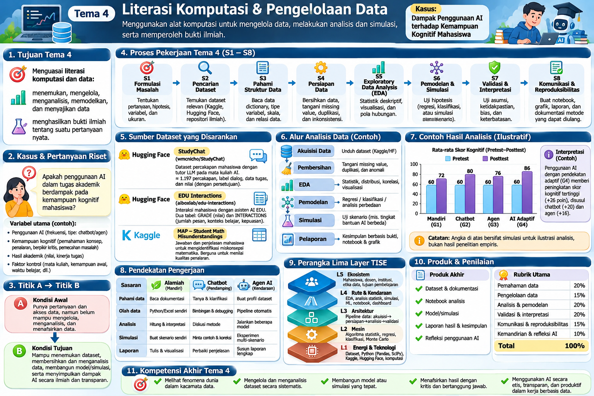

# Tema 4 — Computational and Data Literacy

{#fig-t4 fig-cap="Infografik Tema 4: kasus AI dan kemampuan kognitif, pencarian dataset, pipeline data, simulasi, dan penilaian." width="100%"}

## Data sebagai cara melihat dunia

Tema ini membangun kemampuan memandang fenomena melalui representasi pengukuran. Proses epistemiknya adalah

$$
\text{Fenomena}\rightarrow\text{Pengukuran}\rightarrow\text{Data}\rightarrow
\text{Model}\rightarrow\text{Bukti}\rightarrow\text{Pengetahuan}.
$$

**A:** mahasiswa mempunyai pertanyaan dan akses data tetapi belum mampu memeriksa makna variabel, mempersiapkan data, menganalisis, melakukan simulasi, atau menilai klaim. **B:** mahasiswa membuat analisis yang dapat direproduksi dan dapat menjelaskan hubungan antara realitas, data, model serta keterbatasan inferensinya.

## Kasus: AI dan kemampuan kognitif mahasiswa

**Pertanyaan eksploratoris:** apakah intensitas dan cara mahasiswa menggunakan AI berhubungan dengan hasil akademik dan indikator penalaran? **Pertanyaan kausal yang lebih kuat:** apakah strategi AI tertentu menyebabkan peningkatan kemampuan kognitif yang bertahan tanpa AI?

Nilai ujian, jumlah percakapan, atau frekuensi penggunaan AI **bukan pengukuran langsung tunggal** atas kemampuan kognitif. Dibutuhkan tes konsep, kualitas penalaran, transfer, retensi, kemampuan tanpa AI, atau instrumen lain yang tervalidasi.

## Delapan sasaran antara

S1 rumuskan pertanyaan dan definisi variabel; S2 cari dataset dan baca lisensinya; S3 periksa unit observasi, skala dan data dictionary; S4 bersihkan dan gabungkan data; S5 EDA; S6 model dan simulasi; S7 validasi dan interpretasi; S8 laporan serta notebook reproduktif.

## Sumber dataset dan kecocokan

| Sumber | Tipe data | Bisa dipakai untuk | Keterbatasan |
|---|---|---|---|
| [StudyChat (Hugging Face)](https://huggingface.co/datasets/wmcnicho/StudyChat) | Dialog mahasiswa dengan tutor AI | Strategi bertanya, pola percakapan | Interaksi tidak otomatis mengukur peningkatan kognitif |
| [EDU Interactions](https://huggingface.co/datasets/aiboxlab/edu-interactions) | Interaksi dan nilai akademik | Analisis relasional penggunaan AI–nilai | Bersifat observasional, akses dan skema perlu diperiksa |
| [MAP Student Math Misunderstandings (Kaggle)](https://www.kaggle.com/competitions/map-charting-student-math-misunderstandings) | Jawaban/miskonsepsi matematis | Analisis kualitas penalaran | Tidak mengukur efek penggunaan AI secara langsung |

Periksa kembali lisensi, nama file, izin, serta versi dataset ketika praktikum dimulai. Tidak semua dataset mengizinkan pengunduhan atau redistribusi tanpa syarat. **Buku tidak menyertakan data mentah berlisensi pihak ketiga.**

## Pipeline data

{height="150mm"}

Unit analisis perlu ditentukan terlebih dahulu. Misalnya jika satu mahasiswa memiliki banyak interaksi pada satu mata kuliah, agregasikan per mahasiswa–mata kuliah sebelum bergabung dengan tabel nilai satu baris per unit. Perbedaan level agregasi dapat menyebabkan *many-to-many join* yang salah.

```{python}
#| eval: false
#| echo: true
import pandas as pd
from scipy.stats import spearmanr

# Contoh mengandaikan CSV sudah diunduh sesuai izin dataset.
grades = pd.read_csv("grades.csv")
interaction = pd.read_csv("interactions.csv")
print(grades.columns.tolist(), interaction.columns.tolist())
# Verifikasi nama kolom terhadap data dictionary sebelum mengubah kode.
keys = ["id_aluno", "disciplina"]
usage = interaction.groupby(keys, as_index=False)["qtd_mensagensaluno"].sum()
assert not usage.duplicated(keys).any()
assert not grades.duplicated(keys).any()
df = grades.merge(usage, on=keys, how="left", validate="one_to_one")
# Periksa makna NaN: tidak ada interaksi atau informasi tidak tercatat?
print(df.isna().sum())
clean = df.dropna(subset=["nota_final", "qtd_mensagensaluno"])
print(spearmanr(clean["qtd_mensagensaluno"], clean["nota_final"]))
```

**Penting:** skrip tersebut adalah pola kerja untuk disesuaikan, belum hasil yang dijalankan dan diverifikasi terhadap versi dataset spesifik. Korelasi tidak membuktikan kausalitas; kemampuan awal, intensitas tugas, motivasi, dan seleksi penggunaan AI dapat menjadi pengganggu (*confounders*).

## Pengukuran kemampuan kognitif

| Konstruk | Indikator/instrumen | Catatan validitas |
|---|---|---|
| Pemahaman | Tes konsep tanpa AI | Butir mewakili konsep yang dilatih |
| Penalaran | Rubrik argumentasi | Penilai harus konsisten |
| Transfer | Soal baru | Tidak sekadar mengulang soal latihan |
| Retensi | Tes tertunda | Waktu dan tingkat kesulitan setara |
| Metakognisi | Estimasi yakin vs kinerja | Bedakan kalibrasi dari rasa percaya diri |
| Otonomi | Kinerja saat bantuan dihentikan | Ukur di luar lingkungan AI |

## Desain eksperimen lanjutan

Bandingkan G1 mandiri, G2 chatbot, G3 agen, G4 AI adaptif. Gunakan pretest, posttest, tes tertunda, dan soal transfer; kelompok harus sebanding. Jika memungkinkan, lakukan randomisasi dan cegah kebocoran antara kelompok. Nilai simulasi, bila digunakan untuk belajar pemodelan, **harus diberi label simulasi** dan tidak boleh ditafsirkan sebagai temuan nyata.

## Produk dan rubrik

Dataset beserta provenance, notebook pembersihan dan EDA, model/simulasi, grafik, interpretasi, pemeriksaan asumsi, laporan, dan jurnal bantuan AI.

| Komponen | Bobot |
|---|---:|
| Pemahaman data dan pengukuran | 20% |
| Persiapan data | 15% |
| Analisis dan model | 20% |
| Validasi dan interpretasi | 20% |
| Reproduksibilitas dan komunikasi | 15% |
| Refleksi AI dan kemandirian | 10% |

## Mendefinisikan observasi sebelum menulis kode

Data bukan salinan realitas yang bebas keputusan. Ketika satu baris disebut “penggunaan AI mahasiswa”, peneliti perlu menentukan apakah baris itu sesi, pesan, hari, mata kuliah, atau individu. Seratus pesan dari satu orang tidak sama dengan seratus mahasiswa. Mengabaikan unit observasi dapat membuat hasil tampak jauh lebih pasti daripada informasi yang sebenarnya tersedia.

Buat kamus data sebelum analisis: nama variabel, definisi, satuan, tipe, nilai yang diizinkan, makna kosong, sumber, dan waktu pengukuran. Untuk frekuensi penggunaan, angka nol perlu dibedakan dari data yang tidak tercatat. Untuk skor penalaran, dokumentasikan tugas dan rubrik yang menghasilkannya. Definisi ini menentukan apakah operasi seperti menjumlahkan, merata-ratakan, atau menggabungkan tabel masuk akal.

## Contoh kecil yang memperlihatkan masalah perancu

Tabel berikut sepenuhnya sintetis dan hanya dipakai untuk menjelaskan analisis. Skor adalah angka ilustrasi pada skala 0–100.

| Mahasiswa | Kemampuan awal | Pesan AI | Skor akhir |
|---|---|---:|---:|
| A | Rendah | 20 | 60 |
| B | Rendah | 40 | 65 |
| C | Tinggi | 5 | 85 |
| D | Tinggi | 10 | 90 |

Pada keseluruhan tabel, mahasiswa yang lebih sering memakai AI cenderung mempunyai skor akhir lebih rendah. Namun di dalam setiap kategori kemampuan awal, pemakai yang lebih banyak justru mempunyai skor lebih tinggi. Contoh ini tidak membuktikan manfaat maupun kerugian AI. Ia menunjukkan bahwa hubungan agregat dapat berubah ketika komposisi kelompok diperhatikan. Kemampuan awal dapat memengaruhi penggunaan dan hasil sekaligus.

Dalam inferensi kausal, pertanyaan utamanya bukan hanya apakah dua kolom bergerak bersama, melainkan bagaimana kelompok pembanding dapat mewakili keadaan tanpa perlakuan. Cunningham memberikan pengantar metode dan asumsi untuk pertanyaan sebab-akibat [@cunningham2021]. Untuk praktikum ini, tuliskan jalur yang diduga menghubungkan kemampuan awal, penggunaan AI, motivasi, dan skor sebelum memilih model statistik. Menambahkan banyak variabel ke regresi tidak otomatis menyelesaikan bias; pemilihan penyesuaian harus sesuai pertanyaan dan urutan waktunya.

## Pembersihan sebagai keputusan ilmiah

Jangan menghapus baris hanya karena nilainya mengganggu grafik. Periksa apakah nilai itu kesalahan input, pengukuran yang sah, atau kasus di luar populasi penelitian. Setiap aturan pembersihan dicatat dalam log beserta banyaknya baris yang terpengaruh. Simpan data mentah agar keputusan dapat ditinjau ulang. Praktik komputasi ilmiah yang baik menekankan pengorganisasian data, skrip, dan riwayat perubahan yang dapat dipahami kolaborator [@wilson2017].

Setelah penggabungan tabel, periksa jumlah baris, keunikan kunci, dan kecocokan total yang seharusnya tetap. Jika tabel nilai mempunyai 80 mahasiswa tetapi hasil gabungan menjadi 480 baris, analisis harus berhenti sampai kardinalitas hubungan dipahami. Banyak baris dapat sah untuk analisis per pesan, tetapi tidak boleh langsung digunakan sebagai 480 observasi individu yang independen.

## Validasi model dan pelaporan ketidakpastian

Jika tujuannya prediksi, pisahkan data pelatihan dan pengujian pada unit yang sesuai. Pesan dari mahasiswa yang sama tidak sebaiknya tersebar ke dua bagian ketika targetnya memprediksi pada mahasiswa baru, karena model mungkin mengenali ciri orang tersebut. Pemrosesan yang belajar dari data, seperti imputasi berbasis rata-rata, harus dipasang pada data pelatihan terlebih dahulu. Ini mengurangi kebocoran informasi dari pengujian.

Jika tujuannya membandingkan kelompok, tampilkan ukuran sampel, sebaran, besar perbedaan, dan ketidakpastian yang sesuai desain. Hasil yang tidak menunjukkan perbedaan jelas bukan bukti bahwa kedua strategi identik. Pertimbangkan apakah studi cukup informatif untuk mendeteksi perubahan yang bernilai secara pendidikan. Hindari menerjemahkan setiap angka desimal menjadi kesimpulan praktis.

## Latihan yang dapat direproduksi

Gunakan tabel sintetis di atas untuk membuat scatterplot, kemudian beri penanda kemampuan awal. Jelaskan mengapa dua pembacaan dapat muncul. Tambahkan satu observasi sintetis dengan penggunaan AI tinggi dan kemampuan awal tinggi, lalu periksa apakah kesimpulan agregat berubah. Simpan seluruh versi data dan sebutkan bahwa perubahan tersebut merupakan eksperimen pemodelan.

Laporan akhir harus memisahkan apa yang dihitung, bagaimana hitungan diperoleh, dan apa yang dapat disimpulkan. Reproduksibilitas berarti orang lain dapat menghasilkan hitungan yang sama dari input dan prosedur yang sama. Validitas berarti hitungan tersebut benar-benar mendukung pertanyaan yang diajukan. Notebook yang berjalan tanpa kesalahan belum menjamin keduanya sekaligus.
