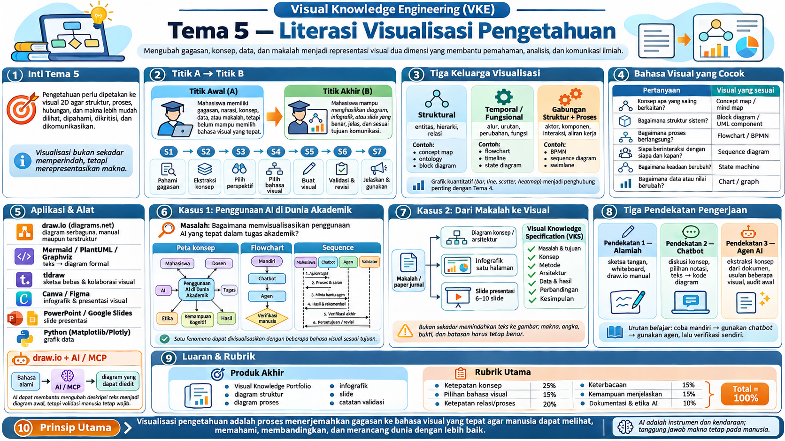

# Tema 5 — Visualization: Visual Knowledge Engineering

{#fig-t5 fig-cap="Infografik Tema 5: jenis visualisasi, pilihan notasi, dua kasus, mode manual–chatbot–agen, dan keluaran." width="100%"}

## Mengapa pengetahuan perlu divisualisasikan?

Pengetahuan dari gagasan, narasi, persamaan, atau data sering memuat banyak relasi. Visualisasi menyajikan **proyeksi terpilih** ke bidang dua dimensi sehingga entitas, arah hubungan, proses, dan pola lebih mudah terlihat. Ini bukan berarti semua pengetahuan wajib direduksi ke dua dimensi; daftar satu dimensi, visual berlapis, dan interaksi juga berguna bila sesuai tujuan.

**A:** mahasiswa memiliki gagasan tetapi belum dapat memodelkan dan memilih notasi visual yang cocok. **B:** mahasiswa mampu membuat diagram yang benar, dapat diedit, dapat dipahami orang lain, dan sesuai struktur pengetahuan.

## Tiga keluarga dan satu pelengkap

| Keluarga | Apa yang diperlihatkan | Bahasa visual |
|---|---|---|
| Struktural | Entitas, relasi, hierarki, ontologi | Concept map, knowledge graph, UML class/component |
| Temporal/fungsional | Langkah, waktu, perubahan keadaan, keputusan | Flowchart, timeline, state machine |
| Struktur + proses | Aktor dan interaksi sepanjang pekerjaan | BPMN swimlane, UML sequence |
| Kuantitatif | Besaran, distribusi, perubahan | Scatterplot, histogram, line chart, heatmap |

Bahasa visual dipilih berdasarkan pertanyaan, bukan berdasarkan perangkat lunak yang paling populer. UML merupakan bahasa/model notasi; draw.io adalah editor; Mermaid/Graphviz merupakan notasi dan perender teks; Python lazim dipakai untuk grafik numerik.

## Langkah pekerjaan S1–S7

S1 tentukan gagasan, pembaca, dan tujuan; S2 ekstraksi entitas/atribut/relasi/peristiwa; S3 tentukan perspektif; S4 pilih notasi dan semantik simbol; S5 gambar atau hasilkan dari teks; S6 periksa makna serta keterbacaan; S7 gunakan untuk penjelasan, diskusi, dan revisi.

## Kasus 1: AI yang tepat dalam dunia akademik

Satu sistem dapat dilihat dari beberapa perspektif.

**Struktur/ontologi:** mahasiswa, dosen, tugas, AI, kebijakan, capaian belajar, hasil karya, dan hubungan antarentitas.

{width="85%"}

**Proses:** mahasiswa mencoba sendiri, memperoleh petunjuk, dan hanya jika perlu mendelegasikan subpekerjaan yang sah; hasil ditinjau dan kompetensi diuji ulang.

{height="150mm"}

**Interaksi:** sequence diagram menekankan kronologi pesan antara mahasiswa, chatbot, agen, dan pemeriksa. Diagram tersebut berfungsi berbeda dari peta struktur.

## Kasus 2: dari satu makalah jurnal menjadi tiga produk

**A:** makalah PDF dengan masalah, teori, metode, data, hasil dan kesimpulan. **B:** *Scientific Visual Communication Package* yang terdiri dari diagram konseptual/proses, infografik satu halaman, dan presentasi 6–10 slide.

Sasaran S1 baca paper; S2 ekstrak pengetahuan; S3 rekonstruksi perjalanan A→B, rute, kendaraan, mesin, teknologi; S4 tentukan satu atau beberapa pesan utama; S5 pilih bahasa visual; S6 buat produk; S7 verifikasi pada paper asli; S8 uji pemahaman audiens dan revisi.

**Visual Knowledge Specification (VKS)** yang harus dibuat sebelum layout:

| Elemen paper | Terjemahan visual | Bukti sumber |
|---|---|---|
| Masalah → tujuan | A→B | Halaman dan paragraf |
| Teori & definisi | Peta konsep/ontologi | Kutipan dan definisi |
| Arsitektur | Block diagram | Diagram/teks metode |
| Langkah eksperimen | Flowchart | Prosedur asli |
| Hasil angka | Grafik / tabel | Data hasil yang valid |
| Keterbatasan | Catatan visual | Discussion / limitations |

### Contoh pembacaan paper TISE 1.0

Ringkasan proyek pada naskah awal mengaitkan TISE 1.0 dengan misi stakeholder, Resource–Mission–Output–Value, pertukaran PSKVE, pasar Mission/Bond/Share, PUDAL, dan multi-agent digital twin. Teks lengkap makalah tidak tersedia dalam direktori kerja saat edisi ini dikembangkan; karena itu uraian ini merupakan konteks proyek yang perlu diperiksa pada makalah asli sebelum dijadikan sumber tugas. Untuk praktikum langsung, gunakan artikel terbuka yang tersedia, misalnya Wilson dkk. [@wilson2017], dan ekstrak pertanyaan, rekomendasi, contoh, serta batasannya dari sumber tersebut.

Untuk **diagram**, prioritaskan arsitektur konsep dan hubungan mekanismenya. Untuk **infografik**, tonjolkan masalah, konsep, komponen, bukti, keterbatasan. Untuk **slide**, rangkai cerita dari konteks, A→B, kontribusi, arsitektur, eksperimen, hasil, sampai implikasi dan keterbatasan. Angka pada hasil visual **harus berasal dari paper**, bukan dihasilkan ulang oleh AI.

## Aplikasi dan integrasi AI

| Perangkat | Fungsi |
|---|---|
| [draw.io / diagrams.net](https://www.drawio.com/) | Menggambar serta mengedit diagram visual |
| [Mermaid](https://mermaid.js.org/) | Flowchart/sequence/state dari kode teks |
| [PlantUML](https://plantuml.com/) | Diagram UML berbasis bahasa teks |
| [Graphviz](https://graphviz.org/) | Layout graf bahasa DOT |
| [tldraw](https://www.tldraw.com/) | Sketsa bebas/kanvas kolaboratif |
| [Canva](https://www.canva.com/), [Figma](https://www.figma.com/) | Infografik dan desain presentasi |
| Python Matplotlib/Plotly | Grafik hasil data yang dapat direproduksi |
| Quarto | Menggabungkan teks, kode, gambar dan hasil ilmiah |

Secara umum, teks → diagram dapat dikerjakan dengan menulis Mermaid atau PlantUML, lalu ditempelkan ke editor yang mendukung. AI dapat menghasilkan teks notasi tersebut. Integrasi MCP memungkinkan asisten berinteraksi dengan aplikasi diagram **jika** konektor tersedia dan pengguna memberinya izin; ketersediaan dan mekanisme login bergantung lingkungan, bukan syarat bawaan semua editor. Untuk draw.io, lihat [dokumentasi resmi](https://www.drawio.com/).

## Tiga moda dan asesmen

**Alamiah:** sketsa di kertas atau editor. **Chatbot:** minta saran visual dan kode diagram, tetap tinjau isinya. **Agen:** delegasi konstruksi beberapa diagram, transformasi layout, dan pemeriksaan awal, lalu revisi oleh manusia.

| Aspek | Bobot |
|---|---:|
| Ketepatan konsep dan sumber | 25% |
| Pemilihan bahasa visual | 15% |
| Ketepatan hubungan/proses | 20% |
| Keterbacaan | 15% |
| Penjelasan tanpa AI | 15% |
| Validasi, dokumentasi dan etika | 10% |

**Produk:** portofolio peta konsep, diagram struktural dan proses, infografik, slide, VKS, jejak validasi, dan refleksi penggunaan AI.

## Menetapkan kalimat yang harus dapat dibaca dari gambar

Sebelum membuka editor, tuliskan satu kalimat tentang apa yang harus dipahami audiens. Kalimat “sistem ini mempunyai empat komponen yang saling bertukar informasi” membutuhkan gambar struktur. Kalimat “permohonan diperiksa sebelum disetujui” membutuhkan proses dan keputusan. Kalimat “skor berubah dari waktu ke waktu” membutuhkan grafik kuantitatif. Mencampur ketiganya dalam satu gambar sering membuat pembaca tidak mengetahui makna panah dan posisi.

Spesifikasi visual juga menentukan hal yang sengaja disederhanakan. Peta komponen dapat menghilangkan rincian algoritma, asalkan tidak menghapus hubungan yang diperlukan untuk memahami sistem. Setiap penyederhanaan mempunyai biaya: gambar lebih ringan, tetapi sebagian pertanyaan tidak dapat dijawab darinya. Nyatakan lingkup gambar pada judul atau keterangan agar audiens tidak menafsirkan kelengkapan yang tidak dimaksudkan.

## Semantik panah dan konsistensi representasi

Dalam peta konsep, panah berlabel “menggunakan” berarti relasi penggunaan. Dalam flowchart, panah biasanya menyatakan perpindahan kendali. Dalam grafik kausal, panah merupakan klaim tentang pengaruh. Bentuk yang sama tidak berarti makna yang sama. Karena itu, VKS perlu memuat kamus simbol dan aturan pembacaan. Jika satu diagram memerlukan lebih dari satu jenis relasi, bedakan dengan label dan legenda yang jelas.

Ambil contoh penggunaan AI dalam kelas. Hubungan “dosen menilai tugas” tidak boleh digambar seolah-olah “dosen menyebabkan mutu tinggi” tanpa dukungan. Demikian pula, garis antara frekuensi chatbot dan nilai bukan bukti sebab-akibat. Gambar mempunyai tanggung jawab epistemik yang sama dengan kalimat: ia perlu membedakan hubungan yang diamati, mekanisme yang diusulkan, dan hasil yang telah diuji.

## Mengomunikasikan angka tanpa menyembunyikan ketidakpastian

Misalkan dua kelompok sintetis mempunyai rerata 72 dan 76. Dua batang dapat membuat selisih terlihat tegas, tetapi tidak memperlihatkan sebaran, ukuran sampel, atau variasi. Pilihan titik individual, boxplot, atau interval dapat memberi informasi tambahan, sesuai tujuan dan karakter data. Jika memakai error bar, jelaskan apakah ia menyatakan simpangan baku, standard error, atau interval kepercayaan; ketiganya tidak mempunyai arti yang sama.

Wilke membahas bagaimana pilihan representasi ketidakpastian memengaruhi penafsiran pembaca [@wilke2019]. Untuk praktik, sediakan tabel sumber di dekat visual agar pembaca dapat memeriksa angka. Periksa juga sumbu, satuan, titik nol, transformasi, dan pembulatan. Sumbu terpotong tidak selalu salah, tetapi harus jelas dan tidak mengubah kesan besar perbedaan secara menyesatkan.

Warna perlu mempunyai fungsi. Gunakan satu warna untuk satu makna yang konsisten, dan hindari menjadikan warna satu-satunya pembeda kategori. Label, bentuk, atau pola membantu pembaca yang mempunyai keterbatasan penglihatan warna maupun yang mencetak hitam-putih. Jika semua komponen diberi warna cerah berbeda, tidak ada penekanan yang membantu audiens menemukan pesan utama.

## Prosedur paper-to-visual yang dapat diaudit

Mulailah dengan tabel ekstraksi: pertanyaan studi, populasi, metode, hasil utama, dan keterbatasan. Untuk setiap angka, tulis lokasi tabel atau paragraf asal. Kemudian tentukan apakah angka akan dipakai apa adanya atau dihitung ulang. Jika menghitung persentase dari tabel, simpan rumus dan penyebutnya. Jangan menggambar selisih persen sebagai selisih poin persentase tanpa penjelasan.

Setelah sketsa jadi, lakukan audit dua arah. Dari gambar menuju sumber, periksa asal setiap klaim. Dari sumber menuju gambar, periksa apakah keterbatasan penting terhapus. Misalnya, hasil simulasi tidak boleh tampil sebagai keberhasilan lapangan. Gambar yang menyatakan hubungan antarvariabel juga tidak boleh menghilangkan kondisi eksperimen yang membuat hubungan itu berlaku.

## Uji pembaca dan latihan revisi

Berikan visual kepada pembaca yang belum mengetahui materinya. Minta ia menjelaskan pesan, urutan proses, dan satu batas kesimpulan. Catat bagian yang dibaca salah tanpa terlebih dahulu mengarahkannya. Jika pembaca mengikuti panah dalam urutan keliru, masalahnya mungkin tata letak atau label, bukan kurangnya pengetahuan pembaca. Revisi lalu uji kembali dengan pertanyaan yang sama.

Sebagai latihan, ambil satu gambar yang mempunyai sedikitnya lima relasi. Tulis seluruh relasi dalam kalimat. Jika kalimatnya ambigu, perbaiki model sebelum memperbaiki warna. Jika kalimat sudah tepat tetapi pembaca masih salah memahami, perbaiki penyajiannya. Perbedaan diagnosis ini membantu peserta memisahkan kesalahan pengetahuan dari kesalahan komunikasi visual.
