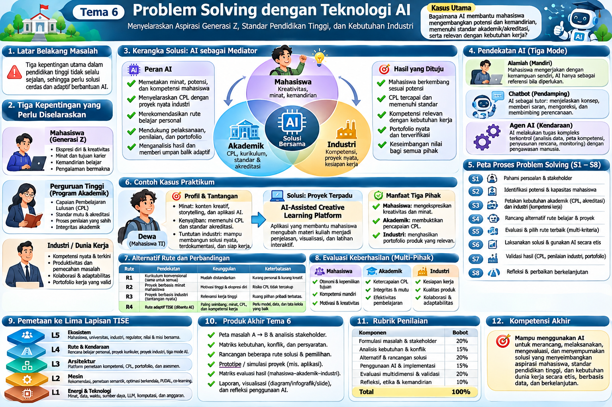

# Tema 6 — Problem Solving: Mahasiswa, Akademik, dan Industri

{#fig-t6 fig-cap="Infografik Tema 6: tiga kepentingan, AI sebagai mediator, pilihan rute, langkah S1–S8, dan evaluasi multi-pihak." width="100%"}

## Satu kasus, tiga misi yang tidak selalu selaras

Tema 6 menjadi tugas integratif dari Tema 1–5. Persoalannya bukan soal dengan satu angka benar, melainkan menyelaraskan **aspirasi dan kemandirian mahasiswa**, **kewajiban mutu/kurikulum/akreditasi program studi**, serta **kebutuhan kompetensi dan produktivitas industri**.

**A:** potensi mahasiswa, capaian pembelajaran lulusan (CPL), dan tuntutan kerja berada dalam sistem yang belum selaras. **B:** rute belajar dan proyek personal yang bermakna, memenuhi CPL dan aturan akademik, serta menghasilkan kompetensi/portofolio kerja yang dapat diuji—dengan dampak etis dan berkelanjutan.

Generasi Z tidak boleh diperlakukan sebagai kelompok homogen. Profil aspirasi harus berasal dari diagnosis peserta, bukan stereotip generasi.

## Stakeholder dan persyaratan

| Pihak | Misi / kepentingan | Bukti yang dibutuhkan |
|---|---|---|
| Mahasiswa | Ekspresi diri, kreativitas, kompetensi, otonomi | Portofolio, refleksi, tes mandiri, kebebasan memilih |
| Program studi | CPL, integritas, standar akademik, akreditasi | Matriks CPL–aktivitas–asesmen, rubrik, audit |
| Industri | Kompetensi, adaptabilitas, kolaborasi, mutu kerja | Tugas kerja autentik, dokumentasi dan evaluasi mitra |

Persyaratan standar wajib dipisahkan dari preferensi yang bisa dinegosiasikan. AI tidak boleh mengesahkan pemenuhan akreditasi atau merekrut seseorang tanpa otorisasi manusia yang berwenang.

## Sasaran antara S1–S8

1. Definisikan masalah dan ketiga stakeholder.
2. Ukur aspirasi, kompetensi, kapasitas dan energi mahasiswa.
3. Petakan CPL, batasan program dan kebutuhan industri.
4. Susun alternatif rute/proyek yang berbeda.
5. Evaluasi alternatif menurut banyak tujuan dan batas keras.
6. Laksanakan proyek melalui moda bantuan yang disetujui.
7. Uji CPL, mutu pekerjaan, serta kemampuan tanpa AI.
8. Refleksi dan perbaiki rute.

## Empat rute penyelesaian

| Alternatif | Kelebihan | Risiko |
|---|---|---|
| R1 Kurikulum konvensional | Standar yang jelas, relatif mudah distandarkan | Kurang sesuai minat individu |
| R2 Proyek pilihan mahasiswa | Motivasi, ekspresi diri | CPL dapat tidak tercakup |
| R3 Tantangan industri | Keaslian pekerjaan, relevansi | Ruang eksplorasi personal terbatas |
| R4 TISE adaptif berbantuan AI | Mencari keselarasan ketiganya | Butuh data, tata kelola dan validasi kuat |

R4 adalah **kandidat**, bukan pemenang yang telah dibuktikan. Penilaian memakai kendala wajib terlebih dahulu, kemudian membandingkan solusi layak menurut mutu, risiko, biaya, otonomi, dan kompetensi kerja.

## Ilustrasi mahasiswa fiktif

Dewa, seorang mahasiswa teknologi informasi, berminat pada konten kreatif, narasi, desain dan AI. Program studi memerlukan bukti pemrograman, data, rekayasa perangkat lunak, komunikasi, kerja tim dan etika; mitra industri ingin produk yang diuji dan didokumentasikan.

**Usulan proyek integratif:** *AI-Assisted Creative Learning Platform* yang membantu pengguna mengubah materi kuliah menjadi penjelasan, visualisasi dan latihan interaktif terverifikasi. Produk ini memberi ruang kreativitas Dewa, artefak untuk asesmen CPL, dan demonstrasi kemampuan pengembangan produk. Kesesuaiannya **tidak otomatis**: pengajar dan industri harus memeriksa bukti aktual.

{width="85%"}

## Peran AI di tiga moda

**Alamiah:** dialog stakeholder, brainstorming, merancang proyek, menghitung trade-off. **Chatbot:** menguji asumsi, menyusun matriks kompetensi, menilai argumen dan opsi. **Agen:** dengan persetujuan dan izin, mengolah peta kompetensi, simulasi jadwal serta skenario, menyiapkan draf proyek dan dokumentasi; keputusan tetap dikendalikan manusia.

## Metrik yang memenuhi ketiga kepentingan

| Kelompok | Ukuran yang diusulkan |
|---|---|
| Mahasiswa | Otonomi, motivasi, kreativitas, pengetahuan dan transfer mandiri |
| Akademik | Cakupan dan pencapaian CPL, validitas asesmen, integritas, efisiensi |
| Industri | Kualitas produk, keterampilan autentik, kolaborasi, adaptabilitas |
| Lintas kelompok | Biaya, waktu, akses adil, privasi, keselamatan, keberlanjutan |

Untuk menghindari *false equivalence* antarskor, tampilkan profil multidimensi dan syarat minimum. Suatu solusi tidak menjadi layak hanya karena skor kelompok lain menutup pelanggaran standar wajib.

## Rancangan pembandingan dan produk akhir

Bandingkan R1–R4 melalui kelompok atau proyek yang sebanding, pretest, posttest, evaluasi CPL, asesmen mitra, produk kerja nyata, serta tes transfer tanpa AI. Laporan harus menjelaskan perbedaan konteks dan keterbatasan inferensi kausal.

**Produk:** peta masalah A–B, kebutuhan/kendala stakeholder, matriks konflik, alternatif rute, rancangan proyek, prototipe/simulasi, pemetaan CPL, asesmen multi-pihak, refleksi dan jejak bantuan AI.

| Rubrik | Bobot |
|---|---:|
| Masalah dan stakeholder | 20% |
| Kebutuhan, kapasitas, konflik | 15% |
| Alternatif serta rancangan | 20% |
| Pemanfaatan AI dan implementasi | 15% |
| Evaluasi dan validasi | 20% |
| Etika, refleksi, kemandirian | 10% |

## Mendengarkan kebutuhan sebelum menawarkan platform

Persoalan multipihak sering dimulai dengan usulan solusi: “buat aplikasi agar mahasiswa siap kerja.” Usulan itu perlu dibuka kembali menjadi kebutuhan. Mahasiswa mungkin membutuhkan kesempatan mencoba peran, dosen membutuhkan bukti kompetensi, dan industri membutuhkan demonstrasi kerja pada batas waktu tertentu. Aplikasi merupakan salah satu kemungkinan sarana. Wawancara singkat, observasi pekerjaan, dan contoh kegagalan yang dialami tiap pihak membantu menemukan masalah yang benar-benar akan ditangani.

Dalam kasus Dewa, dosen meminta demonstrasi pemrograman mandiri, sedangkan Dewa ingin menghasilkan konten kreatif dan mitra meminta produk yang stabil. Tiga kebutuhan tersebut dapat ditampung dalam proyek yang sama apabila pembagian kerjanya jelas. Namun, jika seluruh kode diserahkan kepada agen tanpa pemahaman, portofolio yang terlihat menarik belum membuktikan kompetensi pemrograman. Karena itu, proses perundingan harus menentukan bagian mana yang menjadi produk tim dan bagian mana yang menjadi bukti kemampuan individu.

## Menyaring kelayakan sebelum memberi skor

Tentukan batas keras terlebih dahulu: aturan akademik, keamanan data, waktu, biaya maksimum, dan capaian minimum. Kandidat yang melanggar batas ini tidak masuk pembobotan preferensi. Setelah itu barulah nilai kesesuaian minat, manfaat mitra, peluang belajar, dan keterpeliharaan. Analisis keputusan dalam rekayasa sistem membantu menata perbandingan alternatif dan bukti pemenuhan kebutuhan [@nasa2016]. Adaptasi untuk proyek mahasiswa di sini memakai skala sederhana agar asumsi dapat dibahas.

Contoh berikut memakai skor hipotetis 1–5; semua opsi diasumsikan telah melewati batas keras. Bobot minat 0,30, cakupan kompetensi 0,40, dan manfaat mitra 0,30.

| Proyek | Minat | Kompetensi | Manfaat mitra | Skor berbobot |
|---|---:|---:|---:|---:|
| Portofolio kreatif pribadi | 5 | 3 | 2 | 3,30 |
| Analitik kebutuhan mitra | 3 | 5 | 4 | 4,10 |
| Platform belajar kreatif | 5 | 4 | 4 | 4,30 |

Platform belajar unggul pada bobot tersebut, tetapi hasilnya bergantung pada penilaian dan bobot yang dipilih. Jika manfaat mitra diberi bobot 0,60, kompetensi 0,30, dan minat 0,10, analitik memperoleh 4,20 sedangkan platform 4,10. Perubahan pemenang menunjukkan perlunya percakapan tentang prioritas, bukan alasan untuk menyembunyikan bobot. Tidak ada angka dalam tabel ini yang merupakan evaluasi proyek nyata.

## Memecah proyek menjadi bukti yang dapat diuji

Untuk platform Dewa, milestone pertama dapat berupa satu materi yang diubah menjadi penjelasan dan latihan yang telah diperiksa dosen. Milestone kedua berupa prototipe yang bisa dipakai pengguna baru tanpa penjelasan pengembang. Milestone ketiga berupa demonstrasi bahwa Dewa dapat menjelaskan dan memperbaiki bagian kode yang dipilih reviewer. Ketiga milestone menilai objek berbeda: ketepatan isi, keterpakaian produk, dan kompetensi individu.

Sertakan skenario gagal. Apa yang terjadi jika materi sumber tidak cukup, AI menghasilkan soal salah, atau pengguna mengira penjelasan sebagai sumber resmi? Jawaban desain dapat berupa penanda status sumber, pemeriksaan contoh soal, dan jalur pelaporan kesalahan. Setiap tindakan membutuhkan penanggung jawab. Daftar risiko yang tidak mengubah proses kerja tidak banyak membantu.

## Mengelola konflik tanpa menyerahkan nilai kepada AI

AI dapat merangkum aspirasi dan menyusun alternatif, tetapi tidak menentukan nilai siapa yang harus didahulukan. Jika mitra meminta penggunaan data pelanggan yang tidak tersedia izinnya, tingginya manfaat bisnis tidak menghapus kendala akses. Jika Dewa menginginkan desain kreatif yang menyisakan sedikit waktu untuk cakupan kompetensi, tim dapat mengurangi fitur atau mengubah lingkup demonstrasi. Keputusan demikian memerlukan perundingan manusia yang mencatat alasan dan konsekuensi.

Tinjauan proyek perlu memperlihatkan kelompok mana yang menanggung biaya dan menerima manfaat. Solusi yang menghemat waktu pengelola dengan membebani pengguna tambahan pekerjaan belum tentu perbaikan keseluruhan. Gunakan profil hasil per pihak, lalu diskusikan trade-off secara terbuka.

## Latihan keputusan dan evaluasi setelah pelaksanaan

Pilih satu opsi dalam tabel dan ubah satu asumsi: waktu berkurang setengah, data mitra tidak tersedia, atau kompetensi awal peserta lebih rendah. Susun rute pengganti beserta hasil yang tetap harus dijaga. Jawaban yang baik menyebut apa yang dikurangi, bukti yang masih tersedia, dan alasan rute baru layak.

Sesudah proyek selesai, bandingkan keputusan awal dengan kondisi aktual. Jika produk diterima tetapi peserta gagal menjelaskan metode, nyatakan kedua hasil tersebut secara terpisah. Jika kompetensi meningkat tetapi produk belum stabil, proyek dapat mempunyai nilai pendidikan sekaligus membutuhkan perbaikan teknis. Evaluasi multidimensi membuat hasil seperti ini terlihat dan menjadi dasar rute berikutnya.
